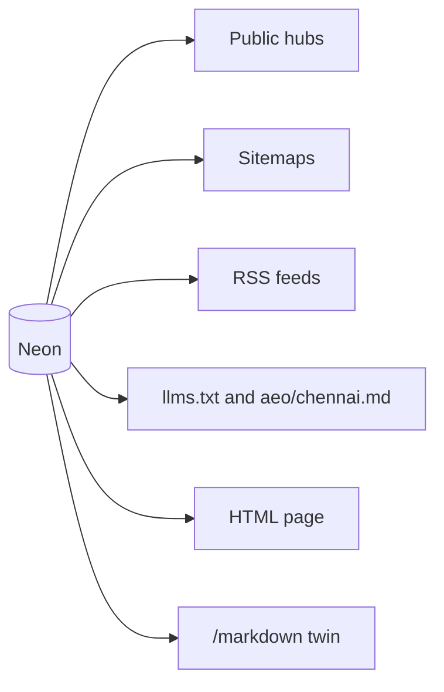
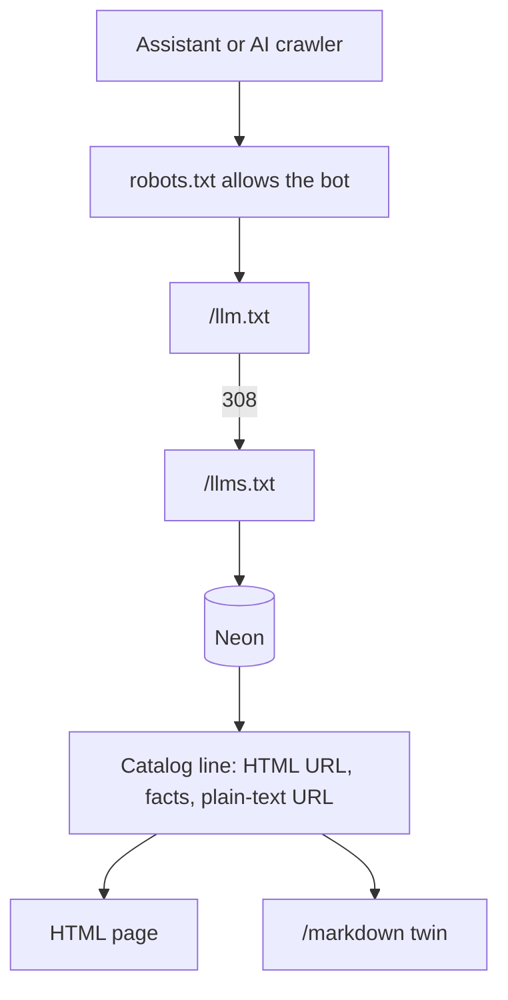
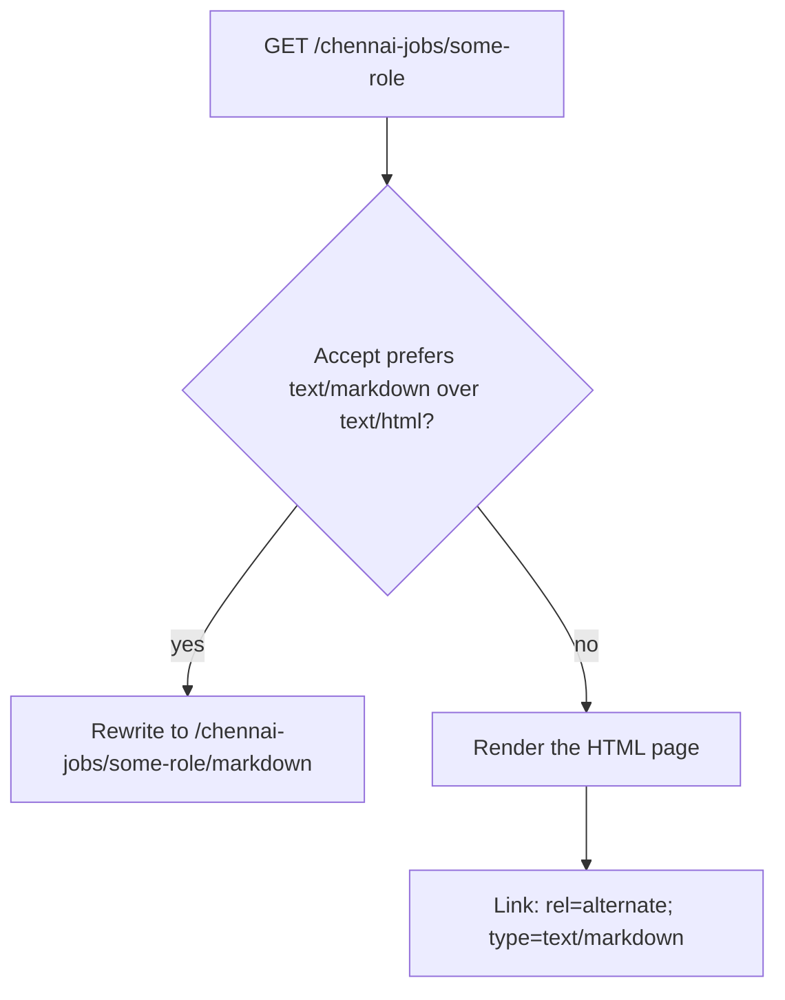
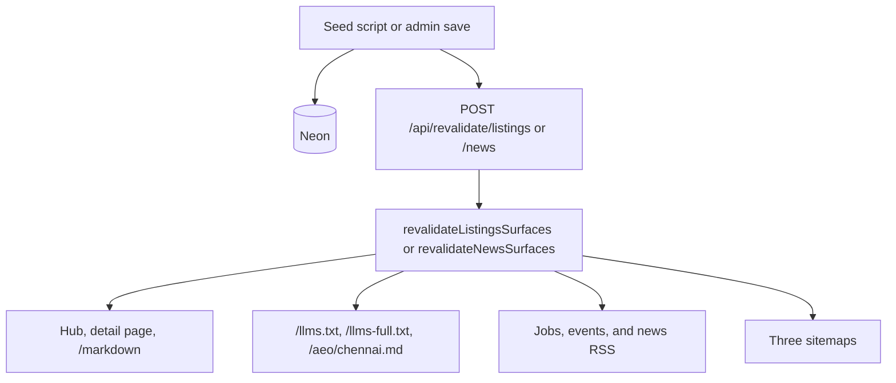

# How AI discovery works on mychennaicity.in

Written 1 November 2026. This is the working record for the live system: what an assistant can fetch, which database rows it is allowed to see, how a page becomes plain text, and what happens after a publish.

It is an operator note, not a ranking promise. `llms.txt` does not by itself change Google AI Overviews. A model can ignore the file, use an old copy, or answer from another site. The file works when the crawler is allowed to read it, the file names a real URL, and that URL still says the same thing.

Answer Engine Optimization (AEO) means a page leads with a sentence a system can quote. Generative Engine Optimization (GEO) means that sentence is easy to find, trust, and cite with a link back to `https://mychennaicity.in`.

Shorter checklist: [`AEO_GEO_PLAN.md`](AEO_GEO_PLAN.md). Classic search ops: [`SEO_ENGINE_PLAN.md`](SEO_ENGINE_PLAN.md).

## Contents

1. [The model](#the-model)
2. [Public addresses](#public-addresses)
3. [Who may read them](#who-may-read-them)
4. [How `/llms.txt` is built](#how-llmstxt-is-built)
5. [What a catalog line contains](#what-a-catalog-line-contains)
6. [The plain-text page](#the-plain-text-page)
7. [Browser and assistant on the same URL](#browser-and-assistant-on-the-same-url)
8. [Publish, cache, and refresh](#publish-cache-and-refresh)
9. [RSS and sitemaps](#rss-and-sitemaps)
10. [One listing, end to end](#one-listing-end-to-end)
11. [When something is missing](#when-something-is-missing)
12. [What this system does not cover](#what-this-system-does-not-cover)
13. [How to check it](#how-to-check-it)
14. [Files](#files)
15. [Not built yet](#not-built-yet)

## The model

One public row in Neon is the source. The hub, the sitemap, the RSS item, the `llms.txt` line, the HTML page, and the Markdown twin all read that row. They do not keep a second copy of the listing.

A row reaches those surfaces only when it is already public on the site:

| Kind | Included | Left out |
| --- | --- | --- |
| Job | `status` is `open`, and `valid_through` is empty or still in the future. Same test as `publiclyOpenJobSql()` in `src/domains/jobs/public-open.ts` | Draft, closed, and past-deadline rows |
| Looking for work | `status` is `open` | Draft and closed notices |
| Event | `status` is `scheduled`, and `COALESCE(ends_at, starts_at)` is still in the future | Draft, cancelled, and finished events. The public URL then 404s |
| News | Published Chennai articles | Drafts |

If the index and the page disagree, the page wins. The index tells the model not to invent a listing.

## Public addresses

All of these are generated on the request. Nothing is written into the repo as a snapshot.

| URL | Response | What it contains |
| --- | --- | --- |
| `https://mychennaicity.in/llms.txt` | `text/plain; charset=utf-8` | Curated hub map, then every current open job, looking-for-work notice, and upcoming event |
| `https://mychennaicity.in/llm.txt` | 308 to `/llms.txt` | Some tools guess this shorter name |
| `https://mychennaicity.in/llms-full.txt` | `text/plain` | The same map and catalog, plus the latest 15 published news stories |
| `https://mychennaicity.in/aeo/chennai.md` | `text/markdown` | The same jobs, notices, and events, written as direct answers, plus 8 news stories |
| `https://mychennaicity.in/humans.txt` | text | Who the site is for, for people |
| `https://mychennaicity.in/chennai-jobs/[slug]/markdown` | `text/markdown` | That open job, without the site layout |
| `https://mychennaicity.in/chennai-jobs/looking-for-work/[slug]/markdown` | `text/markdown` | That open notice |
| `https://mychennaicity.in/chennai-local-events/[slug]/markdown` | `text/markdown` | That upcoming event |
| `https://mychennaicity.in/chennai-local-news/[slug]/markdown` | `text/markdown` | That published article |
| `https://mychennaicity.in/community/mybangalore-whatsapp-community-group` | HTML | Chennai-to-Bengaluru page for the MyBangalore.in WhatsApp community and WhatsApp group |
| `https://mychennaicity.in/community/mybangalore-whatsapp-community-group/markdown` | `text/markdown` | Plain-text twin of that page |

Shared response headers on the text files and the twins:

| Header | Value | Why |
| --- | --- | --- |
| `Cache-Control` | `public, s-maxage=300, stale-while-revalidate=600` | A shared cache may keep the body for about five minutes, and may serve the previous body while it refreshes, for about ten minutes |
| `X-Robots-Tag` | `all` | The text is meant to be indexed and quoted |
| `Vary` | `Accept` | The HTML URL can also return Markdown |

The HTML layout advertises `/llms.txt` and `/llms-full.txt` through `alternates.types` in `src/app/layout.tsx`. The footer links to `/llms.txt`.

`/llms.txt` itself has two parts:

1. A stable map: news, jobs, looking for work, events, areas, gold rate, RSS, the three sitemaps, editorial standards, and the main guides.
2. A live catalog, under the heading “Live Chennai jobs and events”, inserted only when the route successfully asks the database.

The map does not list every guide. Open jobs, notices, and upcoming events are the volume. Everything else stays in the sitemap.

## Who may read them

`src/app/robots.ts` allows the public site to every crawler, including GPTBot, ChatGPT-User, OAI-SearchBot, ClaudeBot, PerplexityBot, Google-Extended, GoogleOther, Applebot-Extended, Bytespider, CCBot, and meta-externalagent. `/admin`, `/super-admin`, and `/api/` are disallowed. The AI files are not under those prefixes, so they are allowed.

The three sitemaps are declared on the same robots file: `/sitemap.xml`, `/news-sitemap.xml`, and `/sitemap-recent.xml`.

## How `/llms.txt` is built

`src/app/llms.txt/route.ts` is `force-dynamic`. A request does this:

1. Call `loadLlmsLiveCatalog()` in `src/lib/seo/llms-live-catalog.ts`.
2. That function reads Neon in parallel: open jobs, the job count, upcoming events, the event count, open notices, and the notice count.
3. If the database throws, the route still returns the hub map, with three empty catalog sections. It does not fail the whole file.
4. `buildLlmsTxtMarkdown()` in `src/lib/seo/llms-txt.ts` turns the rows into Markdown. Every path becomes `https://mychennaicity.in/...`.
5. The response is `text/plain`.

Caps are `LLMS_CATALOG_LIMIT = 400` per section. On 1 November 2026 the live file was under the cap: 51 open jobs, 2 looking-for-work notices, and 8 upcoming events. If a count is higher than the rows returned, the section says how many further rows are only on the hub.

Sort order, from the domain queries:

| Section | Order |
| --- | --- |
| Jobs | Verified employers first, then newest `created_at` |
| Looking for work | Newest `published_at`, then `created_at` |
| Events | Soonest `starts_at` first |
| News on `/llms-full.txt` | Newest published first, 15 rows |
| News on `/aeo/chennai.md` | Newest published first, 8 rows |

`/llms-full.txt` and `/aeo/chennai.md` call the same catalog loader. They do not run a second set of listing rules.

### Job lines, including Tamil

`jobRowsToLlmsDigests()` lists an English slug once. If that role also has an open Tamil twin, the English summary ends with `Tamil page:` and the Tamil URL. A Tamil slug is omitted when its English slug is already in the set. A Tamil-only row is still listed.

Tamil detection is `isTamilJobSlug()` in `src/lib/jobs/job-language.ts`: a `-tamil` suffix, Tamil letters in the slug, or a known Tamil slug pair.

Featured roles come from `activeFeaturedJobCampaigns()` in `src/content/jobs/featured-job-campaigns.ts`. When today’s India date falls inside a campaign, the English summary starts with `Featured:` and the campaign sentence. The Guindy office assistant is the current example. The campaign file is a pin for the site. It does not create the job. The job still has to be an open database row.

### What is removed from the index

`listingSnippet()` and `redactListingContacts()` run on excerpts before they enter `llms.txt`:

- WhatsApp short links
- Email addresses
- Phone-shaped numbers

The model is told to use the listing page for how to apply or how to enter. Pay, place, dates, and the short excerpt stay. A salary such as `₹15,000` is not treated as a phone number.

## What a catalog line contains

A job line is one Markdown bullet. The link is the HTML page. The date in parentheses is the published date in India time. The summary joins the facts with ` · `. Then a second indented line names the plain-text URL.

A job summary can include, when the row has them:

- Featured sentence
- Employer name
- Location, or “Chennai” when the label is empty
- Role type: Full-time, Part-time, Contract, Internship
- Work mode: Office, Work from home, Hybrid, Field
- Pay, only when `salary_disclosed` is true and both minimum and maximum are set. Monthly versus annual follows `formatJobCompensation()`
- Opening count, when it is greater than 1
- “Walk-in”, when the title or body says so
- “Apply by” plus the `valid_through` date in India time
- About 180 characters of the listing, with contacts removed
- Tamil page URL, when the twin is open

A looking-for-work summary can include the seeker label, role sought, location, availability, “Needs accommodation”, and a 180-character excerpt. The section says these are people seeking work, not employer vacancies. Phone, email, and WhatsApp are not copied into this line.

An event line uses the India time range as the date. All-day events omit the clock. The summary joins venue, locality, address, and about 240 characters of the description, again with contacts removed.

A news line on `/llms-full.txt` uses the article title, the news URL, `summary` or else `dek`, the published time, and the plain-text URL. It does not paste the whole story. The story, the disclaimer, and the named source are on the article and on its `/markdown` twin.

## The plain-text page

Each public detail page has a twin at the same path plus `/markdown`. The HTML page stays canonical. The twin is the same public copy without navigation, ads, or the apply-button chrome.

The twin is a route handler, not a second article in the database:

| HTML | Twin |
| --- | --- |
| `src/app/(public)/chennai-jobs/[slug]/page.tsx` | `.../[slug]/markdown/route.ts` |
| `.../looking-for-work/[slug]/page.tsx` | `.../markdown/route.ts` |
| `.../chennai-local-events/[slug]/page.tsx` | `.../markdown/route.ts` |
| `.../chennai-local-news/[slug]/page.tsx` | `.../markdown/route.ts` |

`src/lib/seo/content-markdown.ts` builds the text. Relative links and images in the stored Markdown, written as `](/...)`, are rewritten to `https://mychennaicity.in/...`.

A closed job, a finished event, or an unpublished article returns 404 from the twin, the same as the HTML page. Hubs, `feed.xml`, and `/chennai-local-events/submit` do not get a twin.

### Job twin

Facts, then the stored `body`:

- Page, plain text, employer, location, role type, work mode, pay
- Openings, only when the count is greater than 1
- Apply by, when `valid_through` is set
- Apply, the `application_url` when one is stored. That may be WhatsApp, email, or the employer’s own page
- Tamil page, when the twin is open

The cite note says mychennaicity.in is not the employer.

### Looking-for-work twin

Facts name the kind of page, so a model does not treat the person as a vacancy. Then role, location, availability, accommodation, and the phone, WhatsApp, and email that the HTML page already prints. Then the body.

Those contact fields are on the twin because they are on the public notice. They are still stripped from `llms.txt`.

### Event twin

Page, plain text, when, venue, locality, address, then `description`. Times are India Standard Time. The cite note says to confirm venue and tickets with the organiser.

### News twin

Page, plain text, published date, updated date, source, author. The source line is `Name (url)` when both exist. The body is `summary` or `dek`, then `report_body` (or `body` when the report is empty), then `analysis_body` when that column is set.

The cite note says to attribute official claims to the named source, and that the story includes a civic disclaimer and an AI-assisted fine print. Those sections are inside the report text. The twin does not invent a second disclaimer.

## Browser and assistant on the same URL

`src/middleware.ts` runs on ordinary page requests, after the canonical-host redirect.

`prefersMarkdown()` is true when the `Accept` header contains `text/markdown` and either it does not mention `text/html`, or the Markdown quality is higher. A normal browser sends `text/html` first, so it still gets the page.

| Accept | Result |
| --- | --- |
| `text/html` | HTML page, plus a `Link` header pointing at `/markdown` |
| `text/markdown` | The twin, via an internal rewrite. The visible path can stay the HTML path |
| `text/markdown, text/html;q=0.8` | The twin |
| `text/html, text/markdown;q=0.9` | HTML page |

The stable address to store is the `/markdown` path. `generateMetadata` on the four detail templates also sets `alternates.types['text/markdown']` to that path. The rewrite and the HTML response set `Vary: Accept`.

Only `GET` and `HEAD` are rewritten. The path must be exactly one slug under jobs, events, or news, or one slug under looking-for-work. `feed.xml`, the looking-for-work hub, and the event submit form are skipped.

## Publish, cache, and refresh

Two helpers drop the Next.js cache:

| Helper | Called from | Paths it clears |
| --- | --- | --- |
| `revalidateListingsSurfaces()` | `/admin/jobs` actions, and `POST /api/revalidate/listings` | Home, jobs hub, looking-for-work hub, classifieds hub, events hub, directory, the three sitemaps, `/llms.txt`, `/llms-full.txt`, `/aeo/chennai.md`, jobs RSS, events RSS. When a slug is passed, that detail page and its `/markdown` twin |
| `revalidateNewsSurfaces()` | `POST /api/revalidate/news` | Home, news hub, news RSS, the three sitemaps, the three AI files. When a slug is passed, that article and its `/markdown` twin |

The listings API accepts `secret`, `jobSlug`, `jobSeekerSlug`, `classifiedSlug`, `eventSlug`, `directoryType`, and `directorySlug`. The secret must match `REVALIDATE_SECRET`. A wrong or missing secret returns 401 and changes nothing.

Live seeds call `revalidateListingsAfterSeed()` or `revalidateNewsAfterSeed()` in `scripts/lib/`. Those functions `POST` the API on `https://mychennaicity.in`. If `REVALIDATE_SECRET` is missing in the seed environment, the script logs that it skipped the refresh and still writes the database row. The next uncached read of a `force-dynamic` route will see the row. A shared cache can keep the previous AI file for about five minutes.

Manual refresh from the repo, with production env loaded:

- `npm run revalidate:listings:live`
- `npm run revalidate:listings:live -- --jobSlug=some-slug`
- `npm run revalidate:news:live`

Admin job create, update, publish, and close call `revalidateListingsSurfaces()` in the same server action, so they do not depend on the HTTP secret.

## RSS and sitemaps

| Feed | Rows | Fields in each item |
| --- | --- | --- |
| `/chennai-jobs/feed.xml` | Up to 400 open jobs, same query as the catalog | Title, HTML URL, employer, location, employment type |
| `/chennai-local-events/feed.xml` | Up to 400 upcoming events | Title, HTML URL, venue, locality, start time |
| `/chennai-local-news/feed.xml` | Latest 30 published articles | Title, HTML URL, excerpt |

RSS items point at the HTML page, not the `/markdown` twin. The twin is named from `llms.txt` and from the page’s `Link` header.

Sitemaps list the HTML URLs that are still public. They do not list `/markdown` or `/llms.txt` as the canonical document. `/sitemap-recent.xml` is the last 30 days plus hubs whose `lastmod` is the request time, so crawlers keep returning to the hubs.

JobPosting, Event, and NewsArticle JSON-LD are emitted on the HTML page only, and only for a row that passed the public test. The text files do not emit JSON-LD.

## One listing, end to end

The Guindy office assistant is one `job_postings` row. While it is `open` and `valid_through` is still ahead, that row is visible in all of these:

| Surface | Address |
| --- | --- |
| HTML, canonical | `/chennai-jobs/male-office-assistant-guindy-race-course` |
| Plain text | that path plus `/markdown` |
| Index line | `/llms.txt`, under “Open Chennai jobs” |
| Answer digest | `/aeo/chennai.md`, under “Where are Chennai jobs listed?” |
| Feed | `/chennai-jobs/feed.xml` |
| Sitemap | `/sitemap.xml`, while the row is public |
| Featured pin | The jobs rail, while the campaign in `featured-job-campaigns.ts` includes today |

The index line can say the employer is an individual, the place is Guindy Race Course, the pay is ₹15,000 a month, and the apply-by date is 1 December 2026. The phone number stays on the HTML page and in the Markdown twin’s apply link. It is not copied into the index excerpt.

When `valid_through` passes, or an editor sets `status` to `closed`, the next uncached read drops the row from the hub, the sitemap, the feed, `llms.txt`, and the JSON-LD. The HTML URL and the `/markdown` URL 404. A model that still quotes the old index line is quoting a cache, not the database.

An event follows the same shape with `/chennai-local-events/[slug]`. A news story follows it with `/chennai-local-news/[slug]`, and it appears in the news half of `/llms-full.txt` only while it is among the latest 15.

## When something is missing

| What you see | What it means |
| --- | --- |
| Hub map is present, catalog says nothing is listed | The database read failed, or there really are no open rows. The route does not invent sample listings |
| A job is on `/chennai-jobs` but not in `llms.txt` | It is a Tamil twin of an English row already listed, or it is past the 400 cap, or a cache still holds the previous file |
| `/markdown` is 404 while you expect the page | The row is not public, or this deploy has not finished |
| A browser received Markdown | The request’s `Accept` header ranked `text/markdown` above `text/html` |
| A seed finished and the live file is unchanged | `REVALIDATE_SECRET` was missing, or the CDN is still inside the five-minute window |

## What this system does not cover

These public areas are linked from the hub map. They are not expanded into catalog rows:

- Classifieds
- Gold rate, Chennai Today, and the civic calculators
- Area hubs, as filtered slices of the citywide job and event lists
- A Tamil copy of `llms.txt`. Tamil job URLs are named on the English line

The HTML pages for news, jobs, and events already carry the structured data and, where the page shows them, FAQ and Speakable markup. That work is separate from the text files and is listed in [`AEO_GEO_PLAN.md`](AEO_GEO_PLAN.md).

## How to check it

After a seed or an admin save:

1. Open `https://mychennaicity.in/llms.txt`. It is `text/plain`, and the new job or event URL is in the live catalog.
2. Open that HTML URL. Pay, time, and place match the catalog line.
3. Open the same path plus `/markdown`. The facts match, and the body is the listing or the article.
4. With `Accept: text/markdown` and no `text/html`, the HTML path returns the twin.
5. Close the row, or let `valid_through` pass. The next uncached `llms.txt` omits it, and both URLs 404.

Ask a tool that can browse: “What Chennai jobs does mychennaicity.in list?” A useful answer links to `/chennai-jobs/...`, not to a recalled summary with no URL.

Search Console and Bing still measure ordinary search. A citation inside a chat does not appear there in full. When a chat does link a listing, note the date and the tool.

## Files

| Piece | Path |
| --- | --- |
| Index route | `src/app/llms.txt/route.ts` |
| Alias | `src/app/llm.txt/route.ts` |
| Full digest | `src/app/llms-full.txt/route.ts` |
| Answer digest | `src/app/aeo/chennai.md/route.ts` |
| Catalog query and line text | `src/lib/seo/llms-live-catalog.ts` |
| Hub map and section renderer | `src/lib/seo/llms-txt.ts` |
| Page twin text | `src/lib/seo/content-markdown.ts` |
| Job, notice, event, and news twins | `src/app/(public)/.../[slug]/markdown/route.ts` |
| Accept routing | `src/middleware.ts` |
| Open-job rule | `src/domains/jobs/public-open.ts` |
| After admin save | `src/app/admin/jobs/actions.ts` |
| After seed | `scripts/lib/revalidate-listings-after-seed.ts`, `scripts/lib/revalidate-news-after-seed.ts` |
| Refresh endpoints | `src/app/api/revalidate/listings/route.ts`, `src/app/api/revalidate/news/route.ts` |
| Cache helpers | `src/lib/revalidate-listings-surfaces.ts`, `src/lib/revalidate-news-surfaces.ts` |
| Crawl rules | `src/app/robots.ts` |
| Tests | `src/lib/seo/llms-txt.test.ts`, `src/lib/seo/content-markdown.test.ts` |

## Not built yet

None of these are confirmed ranking factors. They are the gaps left after the catalog and the twins.

1. **Today’s civic facts in `llms.txt`.** Gold rate, Metro Water, and `/chennai-today` are linked, not quoted.
2. **IndexNow** when a URL is published or closed, plus the sitemaps in Bing Webmaster Tools. The repo can submit sitemaps to Google Search Console. It has no IndexNow client.
3. **A visible key-facts list on civic stories**, three to six lines, each with a number, a date, a place, and a named source that already appears in the prose.
4. **Open classifieds in the catalog**, with price only when the listing publishes one, and with phone numbers left on the page.
5. **A Tamil digest**, so a Tamil prompt meets the Tamil URL first.
6. **JSON Feed** beside RSS, using the same rows.
7. **Author pages** for bylines that already have `author_byline` and `author_same_as`.
8. **A dated public corrections list.** `/editorial-standards` explains corrections. It does not list them.
9. **Image credits and `VideoObject`** for photos and classified walkthroughs we actually host.
10. **A small JSON document for today’s gold rate**, with the timestamp already shown on the gold page.
11. **A short FAQ on ordinary event pages**, only when the poster answers the question.
12. **A count of AI crawler fetches** of `/llms.txt` and detail URLs, without storing visitor IPs in the engagement table.
13. **A Wikidata item** for the publication, after the about page and profiles are stable.
14. **Area slices** such as “jobs in Velachery”, without inventing a thin page per neighbourhood.

Leave these alone:

- Keyword-stuffed descriptions, or a hub map that lists every guide.
- JSON-LD for a mock, closed, or unpublished row.
- Blocking GPTBot, ClaudeBot, or PerplexityBot.
- A line in `llms.txt` that claims a tool must prefer this site.
- Seeker or classified phone numbers inside `llms.txt`.
- A private custom assistant as a substitute for the public URL.
