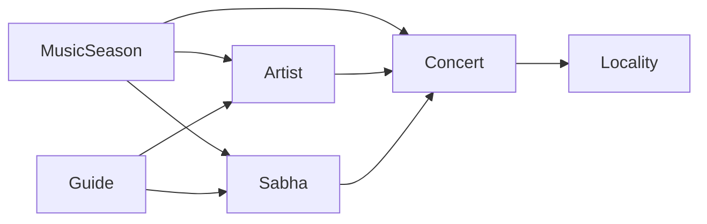

# Music season system

This is the only music-season plan file. The prompts, the progress lines, and the version log are in this document. Do not open a second plan.

Current version: **1.11**  
Last updated: **2026-11-27 15:16 IST**

## Version log

Add a new row at the top when this file changes. Bump the minor number for a prompt or a progress note. Bump the major number when the file is restructured.

- **1.11** — 2026-11-27 15:16 IST — Kiran & Nivi’s artist page is `/music/artist/sai-sisters-kiran-nivi`. `/music/artist/kiran-nivi` redirects there.
- **1.10** — 2026-11-27 15:00 IST — Kiran & Nivi, Sai Sisters, have an artist page at `/music/artist/kiran-nivi`. The sheet prints ten lines. Mumbai and the 26 December MDND line (Location TBD, no hall) stay on that page. Eight Chennai lines are event rows.
- **1.9** — 2026-11-27 00:40 IST — Spoorthi Rao’s Margazhi 2026–27 sheet is an artist page at `/music/artist/spoorthi-rao`. Her 3 December line prints Youth Hostel Auditorium, Adyar, and does not print a programme. The Margazhi Maha Utsavam row for that slot stays Vaishnavam at Indra Nagar, with free entry, and is not seeded again from her sheet.
- **1.8** — 2026-11-26 19:40 IST — `/music` opens one hall at a time. A new sheet picks the next colour, a unique switcher label, and a sheet link when the printed name matches one artist page. Counts come from the rows, not from a fixed hall total.
- **1.7** — 2026-11-26 19:30 IST — `/music` is a season booklet for the three printed sheets already listed: cover, next four, date rail, hall colour, name filter, and concert rows with the printed start time. Same anchors, same event links. Madhuradhwani stays off the page.
- **1.6** — 2026-11-26 18:30 IST — Collected the Madhuradhwani concerts page: 122 slots at Arkay Convention Center, Mylapore, from 21 November 2026 through 31 December 2026. Draft only. No page and no event seed.
- **1.5** — 2026-11-26 16:20 IST — The three collected sheets are event rows, listed at `/music`. Music sitemap: `/music-sitemap.xml`. Plain text: `/music/llms.txt`. Ramana’s 19 December Vani Mahal row and Jayanthi’s 2 January Strings Attached row are not reseeded.
- **1.4** — 2026-11-26 13:20 IST — Collected the Kartik Fine Arts 12 December 2026 poster: two slots at Narada Gana Sabha Main Hall. Draft only. No page and no event seed.
- **1.3** — 2026-11-26 13:16 IST — Collected the Sri Thyaga Brahma Gana Sabha Isai Vizha sheet: 39 slots at Vani Mahal, T-Nagar. Draft only. No page and no event seed.
- **1.2** — 2026-11-26 13:08 IST — Collected the Margazhi Maha Utsavam poster: 22 slots at Youth Hostel Auditorium, Indra Nagar. Draft only. No page and no event seed.
- **1.1** — 2026-11-26 11:20 IST — Added prompt 25: active kutcheri artists in the past year, across sabhas and kovil kutcheris, in three bands (senior evening, mid-slot, junior or fresh-face).
- **1.0** — 2026-11-25 17:27 IST — Merged the system plan and the 24 prompts into this file. Removed `docs/prompts/MUSIC_SEASON_AI_BRIEFS.md`.
- **0.4** — 2026-11-25 17:27 IST — Rewrote each prompt as a full brief: role, fields, blank rules, and a count before the answer.
- **0.3** — 2026-11-25 17:18 IST — Recorded 24 copy-paste prompts, each with Status, Collected, Implemented, and Live URL.
- **0.2** — 2026-11-25 17:00 IST — Saved the plan in docs and split the short briefs into a second file.
- **0.1** — 2026-11-25 16:52 IST — Drafted the season graph, the page map, the order of work, and the search rules.

## Implementation log

Record a published page here and under the prompt that supplied the facts.

- No season page from these prompts has been published yet. The live artist sheets, sabha page, and concert rows listed below were published before this file.
- **2026-11-27:** Kiran & Nivi, Sai Sisters — `/music/artist/sai-sisters-kiran-nivi`. Eight Chennai dates from the Margazhi Concert Schedule 2026-2027. Mumbai and the unplaced MDND line stay on the artist page.

Document this first. Do not build the later waves until the desk has a source for each fact. The live core stays: `/music/artist`, `/music/sabha`, and `/chennai-local-events`. A new idea becomes a page only when it answers one question and links back into that graph.

Paste a reply under the matching prompt further down in this file. Then update that prompt’s four progress lines and add a version-log row.

A poster that is one hall and many artists does not match prompts 1–25. File that reading under Collected sheets. Do not seed it until the desk has checked the rows against the image.

## Collected sheets

### Margazhi Maha Utsavam, Youth Hostel Auditorium

- **Status:** implemented
- **Collected:** 2026-11-26, Cursor, this section. Source image: `docs/music-season-sources/margazhi-maha-utsavam-youth-hostel-indra-nagar-2026.png`
- **Implemented:** 2026-11-26, `scripts/seed-event-music-season-sheets-2026.ts`
- **Live URL:** https://mychennaicity.in/music#margazhi-maha-utsavam

Date rows on the poster: 11. Slots on each date: 2. Rows below: 22.

Printed once for the whole sheet, so these fields are the same on every row:

- sabha: Margazhi Maha Utsavam
- hall: Youth Hostel Auditorium
- locality: Indra Nagar
- city: Chennai
- start: the column head, `4:45 pm` or `6:45 pm`
- finish: blank. No finish is printed.
- ticket URL: blank
- fare: `ENTRY FREE`, printed once in the footer, not on each date line
- also printed in the footer: `ALL ARE WELCOME`
- address line, quoted: `Youth Hostel Auditorium, Hamsadwani, Indra Nagar, Chennai.`
- marks on the poster: `விஜய்`; `Ragamalika TV`; `YouTube/RagamalikaTV`
- no street, PIN, phone, or ticket site is printed

The programme line is quoted as printed, including odd spellings. A slash joins two printed lines in one cell. `withLine` is filled only where the poster prints `with`.

| # | Date as printed | Start | Artist as printed | Programme as printed | withLine |
| --- | --- | --- | --- | --- | --- |
| 1 | DEC 1, 2026 TUESDAY | 4:45 pm | VISHNUDEV & MYLAI KARTHIKEYAN | MANGALA NAADHAM / - A Grand invocation concert | |
| 2 | DEC 1, 2026 TUESDAY | 6:45 pm | GAYATHRI VENKATRAGHAVAN | MSS 110 - THAMIZH TEHLLAMUDHU | |
| 3 | DEC 2, 2026 WEDNESDAY | 4:45 pm | S MAHATHI | VARNAMALIKA | |
| 4 | DEC 2, 2026 WEDNESDAY | 6:45 pm | VIGNESH ISHWAR | ORE RAGAM ORAYIRAM BHAAVAM | |
| 5 | DEC 3, 2026 THURSDAY | 4:45 pm | SPOORTHI RAO | VAISHNAVAM | |
| 6 | DEC 3, 2026 THURSDAY | 6:45 pm | TRICHUR BROTHERS | அவள் - The all powerful women | |
| 7 | DEC 4, 2026 FRIDAY | 4:45 pm | RAMANA BALACHANDAR | ONE WITH SIVAN / - A tribute to Papananasam Sivan | |
| 8 | DEC 4, 2026 FRIDAY | 6:45 pm | SIKKIL GURUCHARAN | தென்மேற்கு பக்தி காற்று | |
| 9 | DEC 5, 2026 SATURDAY | 4:45 pm | BALAMURALIKRISHNA | பின்னே வரும் முன்னே !! | |
| 10 | DEC 5, 2026 SATURDAY | 6:45 pm | SUDHA RAGUNATHAN | GURU MAHIMA | |
| 11 | DEC 6, 2026 SUNDAY | 4:45 pm | BHARAT SUNDAR | எது(வும்) பக்தி | |
| 12 | DEC 6, 2026 SUNDAY | 6:45 pm | DR S SOWMYA | NAVARATNAM | |
| 13 | DEC 7, 2026 MONDAY | 4:45 pm | AMRUTHA VENKATESH | Chandiran : The Moon , Moods and Musings | |
| 14 | DEC 7, 2026 MONDAY | 6:45 pm | VIJAY SIVA | Om Shanthi Shanthi Shanthihi | |
| 15 | DEC 8, 2026 TUESDAY | 4:45 pm | CARNATICA BROTHERS | SANGEETHA NUMEROLOGY | |
| 16 | DEC 8, 2026 TUESDAY | 6:45 pm | SRIRANJANI TAPASYA SANTHANAGOPALAN | LOVE | |
| 17 | DEC 9, 2026 WEDNESDAY | 4:45 pm | JAYANT J A | MAALIYIN MAHIMAI | |
| 18 | DEC 9, 2026 WEDNESDAY | 6:45 pm | SANDEEP NARAYAN | Umaiyor Baganum-Umaiyor Pillaiyum | |
| 19 | DEC 10, 2026 THURSDAY | 4:45 pm | KRUTHI BHAT | "RAGA RATNAMALIKA" | |
| 20 | DEC 10, 2026 THURSDAY | 6:45 pm | DUSHYANT SRIDHAR | 'Silapathigaram' | ADHITHYA MADHAVAN |
| 21 | DEC 11, 2026 FRIDAY | 4:45 pm | VK MANIMARAN & MADHUSUDHANAN KALAICHELVAN | CHOZHAM | |
| 22 | DEC 11, 2026 FRIDAY | 6:45 pm | SUBHASREE THANIKACHALAM | BHARA"THEE" / The Multifacets of Mahakavi by SUBHASREE THANIKACHALAM | VIDYA, VINAYA & SAINDHAVI |

Unreadable: on 5 December at 4:45 pm, a smaller line sits under `பின்னே வரும் முன்னே !!`. The letters are too small to read, so that line is left blank.

Desk check before any page: Ramana Balachandran’s sheet already lists 4 December 2026 at 4:45 pm for Margazhi Maha Utsavam, with S. Hariharan and Sunil Kumar, and no city. This poster prints the hall and Chennai, the programme ONE WITH SIVAN, the spelling RAMANA BALACHANDAR, and no accompanists. The two sheets are not merged.

### Sri Thyaga Brahma Gana Sabha, Vani Mahal

- **Status:** implemented
- **Collected:** 2026-11-26, Cursor, this section. Source image: `docs/music-season-sources/sri-thyaga-brahma-gana-sabha-isai-vizha-vani-mahal.png`
- **Implemented:** 2026-11-26, `scripts/seed-event-music-season-sheets-2026.ts`
- **Live URL:** https://mychennaicity.in/music#vani-mahal-isai-vizha

The sheet is two date lists side by side. Left dates: 20, from `10th Dec. 2026` through `29th Dec. 2026`. Right dates: 19, from `30th Dec. 2026` through `16th Jan. 2027`, then a last cell that prints `17th Dec. 2026`. Rows below: 39.

Printed once for the whole sheet:

- sabha: SRI THYAGA BRAHMA GANA SABHA
- also printed: `"VANI MAHAL"` and `(Regd.)`
- series: `ISAI VIZHA - 6.30 PM CONCERTS`
- hall: Vani Mahal
- locality: T-Nagar
- city: Chennai
- address line, quoted: `Venue: Vani Mahal, T-Nagar, Chennai`
- start: `6.30 PM` for every row. No finish is printed.
- ticket line, quoted: `TICKETS ON MDnD`
- ticket URL: blank. No fare amount is printed.
- the seal prints `80`. Smaller words on the seal were not read.
- no street, PIN, or phone is printed

A slash joins two printed lines in one cell. Spellings stay as printed.

| # | Date as printed | Artist and programme as printed |
| --- | --- | --- |
| 1 | 10th Dec. 2026 | G. Ravikiran - Vocal |
| 2 | 11th Dec. 2026 | Sikkil C Gurucharan - Vocal |
| 3 | 12th Dec. 2026 | Sandeep Narayan - Vocal |
| 4 | 13th Dec. 2026 | Ranjani & Gayatri - Vocal |
| 5 | 14th Dec. 2026 | Sanjay Subramaniam - Vocal |
| 6 | 15th Dec. 2026 | Gayathri Venkataraghavan - Vocal |
| 7 | 16th Dec. 2026 | Kunnakkudi / M Balamuralikrishna - Vocal |
| 8 | 17th Dec. 2026 | K. Bharat Sundar - Vocal |
| 9 | 18th Dec. 2026 | Trichur Brothers (Srikrishna Mohan & Ramkumar Mohan) - Vocal |
| 10 | 19th Dec. 2026 | Ramana Balachandhran - Veena |
| 11 | 20th Dec. 2026 | Palaghat Dr. R. Ramprasad - Vocal |
| 12 | 21st Dec. 2026 | S. Saketharaman - Vocal |
| 13 | 22nd Dec. 2026 | N. Vijay Siva - Vocal |
| 14 | 23rd Dec. 2026 | U.Ve Dushyanth Sridhar & Party / Upanyasam |
| 15 | 24th Dec. 2026 | K.S.Vishnudev - Vocal |
| 16 | 25th Dec. 2026 | Rajhesh Vaidhya & U Rajesh / Veena & Mandolin |
| 17 | 26th Dec. 2026 | S.Mahathi - Vocal |
| 18 | 27th Dec. 2026 | Ramakrishnan Murthy - Vocal |
| 19 | 28th Dec. 2026 | Malladi Brothers (Sreerama Prasad & Dr.Ravikumar) - Vocal |
| 20 | 29th Dec. 2026 | Akkarai Sisters (S Subhalakshmi & S Sornlatha) - Vocal |
| 21 | 30th Dec. 2026 | Sangeetha Upanyasam on "EPPADI PAADINARO" by Vishaka Hari |
| 22 | 31st Dec. 2026 | Abhishek Raghuram - Vocal |
| 23 | 01st Jan. 2027 | J.A.Jayant - Flute |
| 24 | 02nd Jan. 2027 | Dr. Jayanthi Kumaresh & R. Kumaresh - Strings Attached |
| 25 | 03rd Jan. 2027 | Vid. Sid Sriram - Vocal |
| 26 | 04th Jan. 2027 | Sridevi Nrithyalaya presents / Kanda Guru Kavasam - Dance Drama |
| 27 | 05th Jan. 2027 | Srekala Bharat and Thejus presents "MOKSHA MARGAM", a group bharathanatyam |
| 28 | 06th Jan. 2027 | Nada Gurukulam Presents / "SAKTHI PRABHAVAM" Dance Drama |
| 29 | 07th Jan. 2027 | Nrithyakshethra Dance Academy presents Madurai R Muralidharan's "Sri Krishna Leela" a dance musical |
| 30 | 08th Jan. 2027 | Saila Sudha presents "AZHAGAN MURUGAN" - Bharathanatyam |
| 31 | 09th Jan. 2027 | Sudha Raghunathan - Vocal |
| 32 | 10th Jan. 2027 | "Nritya - Nama sankeerthanam" a dance ballet in Bhajan sampradaya by Dr Rajeswari Sainath & Dr Yashnavi Sainath prabhu |
| 33 | 11th Jan. 2027 | Narayana Teertha's Krishna Leela Tarangam / Choreographed by Smt Jayanthi Subramaniam |
| 34 | 12th Jan. 2027 | Sri Sai Nrithyalaya presents bharathanatyam dance drama "Hari Hara Nandhan" by H N Nandhini Suresh |
| 35 | 13th Jan. 2027 | Kripa's centre for fine arts presents Munma oru kaalaththula / (once upon a time..) / A thematic natya presentation |
| 36 | 14th Jan. 2027 | Stage creations present Kathadi Sri Ramamurthy in / Pillayar Pidikka by Sri SL Naanu |
| 37 | 15th Jan. 2027 | Crazy Creations presents Maadhu Balaji & his Crazy Team in "Madhil Mel Maadhu" |
| 38 | 16th Jan. 2027 | Y Gee Mahendra in and as "VARADU KUTTY PARITCHAIKKU NERAMACHU 2" |
| 39 | 17th Dec. 2026 | Dummies Drama presents "KAANAL NEERO" by Sreevathson |

Unreadable: the small type on the `80` seal.

The last date cell prints `17th Dec. 2026`. The cell above it prints `Jan. 2027`. The year is left as printed.

Desk check before any page:

- Ramana Balachandran’s sheet already lists 19 December 2026 at 6:30 pm at Vani Mahal, with Sai Giridhar and Anirudh Athreya. This poster prints `Ramana Balachandhran - Veena` and no accompanists.
- Jayanthi Kumaresh’s sheet already lists Strings Attached at Vani Mahal on 2 January 2027 at 6:30 pm, and does not name R. Kumaresh. This poster prints `Dr. Jayanthi Kumaresh & R. Kumaresh - Strings Attached` on `02nd Jan. 2027`.
- Her sheet also lists the Vani Kala Sudhakara Award at Vani Mahal on 9 December 2026. That date is not on this Isai Vizha grid.

The sheets are not merged.

### Kartik Fine Arts, 12 December 2026

- **Status:** implemented
- **Collected:** 2026-11-26, Cursor, this section. Source image: `docs/music-season-sources/kartik-fine-arts-52nd-year-art-festival-12-dec-2026.png`
- **Implemented:** 2026-11-26, `scripts/seed-event-music-season-sheets-2026.ts`
- **Live URL:** https://mychennaicity.in/music#kartik-fine-arts-12-dec-2026

Date badges on the poster: 1. Slots: 2. Rows below: 2. No weekday is printed.

Printed once for the whole sheet:

- organiser line: `KARTIK FINE ARTS`
- series: `52nd YEAR ART FESTIVAL 2026`
- hall line, quoted: `Narada Gana Sabha, Main Hall, Chennai`
- date badge: `12` / `DEC` / `2026`
- finish: blank. No finish is printed.
- ticket line, quoted: `TICKETS ON MDnD`
- ticket URL: blank. No fare amount is printed.
- associate sponsor, quoted: `SHRIRAM` and `Finance`, under the words `Associate Sponsor`
- main sponsor: the words `Main Sponsor` sit over a round logo. The upper ring reads `NEELAMAI FOUNDATION`. The lower arc and the words inside the ring were not read cleanly.
- no street, PIN, or phone is printed
- a portrait is not an instrument. An instrument is recorded only where the poster prints it in parentheses.

| # | Date as printed | Start | Artist as printed | withLine |
| --- | --- | --- | --- | --- |
| 1 | 12 DEC 2026 | 4.30 pm | 'Isai Chudar' Dr.N.J. Nandini | Mysore V. Srikanth, Praveen Sparsh, Guru Prasanna (Kanjira) |
| 2 | 12 DEC 2026 | 6.45 pm | 'Isai Peroli' Dr. Sudha Ragunathan | H.N. Smitha, K.V. Prasad, R. Raman (Morsing) |

The names under each artist are printed as a list. The poster does not print the word `with`.

Desk check: other sheets already use this hall on other days. Charumathi Raghuraman is 24 December 2026. Ramana Balachandran is 29 December 2026. Those rows are not this date, so they are not merged.

### Madhuradhwani, Arkay Convention Center

- **Status:** collected
- **Collected:** 2026-11-26, Cursor, this section. Source page: https://madhuradhwani.in/public/concerts.php. Snapshot of the page script: `docs/music-season-sources/madhuradhwani-concerts-2026-11-26.json`
- **Implemented:**
- **Live URL:**

The concerts page keeps the full list in a script, `const events=`, 122 objects. Ids run from 34 to 156. Id 80 is absent. Dates run from `2026-11-21` through `2026-12-31`. The dates `2026-12-25` through `2026-12-30` are absent.

The Past Events block on the fetched page shows six cards, 23 to 25 November 2026. The calendar and the list read the same 122 objects. `series_title` is empty on every object. The series name sits inside `title`.

Printed once for the whole page:

- sabha: Madhuradhwani
- also printed: `CARNATIC MUSIC` and `© 2026 Madhuradhwani. All rights reserved.`
- hall: `Arkay Convention Center` on every `venue`
- locality: Mylapore
- city: Chennai
- address line, quoted: `Arkay Convention Center` and `Mylapore, Chennai – 600004`
- phone, quoted: `+91 99625 54080`
- email, quoted: `asrk@arkay.co.in`
- YouTube, quoted: `https://www.youtube.com/@ArkayRamakrishnan`
- Facebook, quoted: `https://www.facebook.com/arkayconvention`
- Instagram, quoted: `https://www.instagram.com/arkayconven/`
- finish: blank. No finish is stored.
- ticket URL: blank. No fare is stored.
- no street is printed on this page

A slash joins stored lines in `description`. Spellings stay as stored. A live URL is filled only where `live_url` is non-empty. Ids 34 through 55 have one. Later ids leave it blank.

Rows below: 122.

| # | id | Date | Start | Title as stored | Lines as stored | Live URL |
| --- | --- | --- | --- | --- | --- | --- |
| 1 | 34 | 2026-11-21 | 3:45 PM | 16th Anniversary Concerts - Vannai A N Balamurugan – Nagaswaram | Vannai A N Balamurugan Nagaswaram / Vannai B Kishorekumar B E Nagaswaram / Mangalam M K Asan Tavil / Solavaram S Loganathan Tavil | https://www.youtube.com/watch?v=sTQfApDddu0 |
| 2 | 35 | 2026-11-21 | 5:15 PM | 16th Anniversary Inauguration | Sri Nalli Kuppuswamy Chettiar / Cleveland V V Sundaram / Dr Ritha Rajan / Nagai Muralidharan | https://www.youtube.com/watch?v=w_KOzENAmk8 |
| 3 | 36 | 2026-11-21 | 6:30 PM | 16th Anniversary Concerts - Inaugural Concert – Thoppur Sairam – Vocal | Programme:  / Inaugural Concert | https://www.youtube.com/watch?v=uSb9Jkgl-zU |
| 4 | 55 | 2026-11-22 | 10:00 AM | Arangetram –Akshay K Vocal |  | https://www.youtube.com/watch?v=eDNzhSRc_iI |
| 5 | 37 | 2026-11-22 | 4:15 PM | 16th Anniversary Concerts - Deepika & Nandhika  – Vocal Duet | Deepika & Nandhika Vocal / Bombay R Madhavan Violin / Kishore Ramesh Mridangam / Sunil Kumar Kanjira | https://www.youtube.com/watch?v=fV37eZhitFk |
| 6 | 38 | 2026-11-22 | 6:30 PM | 16th Anniversary Concerts - A S Murali – Vocal | A S Murali Vocal / B U Ganesh Prasad Violin / Mannargudi Easwaran Mridangam / B S Purushotham Kanjira | https://www.youtube.com/watch?v=n9fgM3okn6Q |
| 7 | 39 | 2026-11-23 | 4:15 PM | 16th Anniversary Concerts - Swarathmika Srikanth – Vocal | Swarathmika Srikanth Vocal / Shradda Ravindran Violin / Thirucherai Kaushik Mridangam / Harihara Subramanian Ghatam | https://www.youtube.com/watch?v=j2qrFNIJ5Us |
| 8 | 40 | 2026-11-23 | 6:30 PM | 16th Anniversary Concerts - K S Vishnudev – Vocal | K S Vishnudev Vocal / Vittal Rangan Violin / Patri Satish Kumar Mridangam / K V Gopalakrishnan Kanjira | https://www.youtube.com/watch?v=Om2KQLrHyB4 |
| 9 | 41 | 2026-11-24 | 4:15 PM | 16th Anniversary Concerts - Niranjan Dindodi – Vocal | Niranjan Dindodi Vocal / Thirucherai Karthik Violin / Aduthurai Guruprasad Mridangam / Giridhari Prasad Kanjira | https://www.youtube.com/watch?v=vWS0xJok0R0 |
| 10 | 42 | 2026-11-24 | 6:30 PM | 16th Anniversary Concerts - Amrutha Venkatesh – Vocal | Amrutha Venkatesh Vocal / Bombay R Madhavan Violin / S J Arjun Ganesh Mridangam / G Chandrasekara Sharma Ghatam | https://www.youtube.com/watch?v=9MVdqJA3vVk |
| 11 | 43 | 2026-11-25 | 4:15 PM | 16th Anniversary Concerts - Malavika Sundar – Vocal | Malavika Sundar – Vocal / M. Vijay – Violin / Guru Raghavendra – Mridangam / Nerkunam Dr. S. Sankar – Kanjira | https://www.youtube.com/watch?v=AGnY397T7iU |
| 12 | 44 | 2026-11-25 | 6:30 PM | 16th Anniversary Concerts - Shertallay Dr K N Renganatha Sharma – Vocal | Shertallay Dr K N Renganatha Sharma Vocal / S Varadarajan Violin / Thanjavur Murugaboopathy Mridangam / B S Purushotham Kanjira | https://www.youtube.com/watch?v=0GDL1M6N1eM |
| 13 | 45 | 2026-11-26 | 4:15 PM | 16th Anniversary Concerts - V Navaneet Krishnan – Vocal | V Navaneet Krishnan Vocal / Madan Mohan Violin / Kallidai Sivakumar Mridangam | https://www.youtube.com/watch?v=Cnx09xGXNKA |
| 14 | 46 | 2026-11-26 | 6:30 PM | 16th Anniversary Concerts - A Kanyakumari – Violin | A Kanyakumari Violin / Rajeev Mukundan Violin / Patri Satishkumar Mridangam / Anirudh Athreya Kanjira | https://www.youtube.com/watch?v=G2Z68MYumOU |
| 15 | 47 | 2026-11-27 | 4:15 PM | 16th Anniversary Concerts - Akshay Padmanabhan – Vocal | Akshay Padmanabhan Vocal / Arunachala Karthik Violin / Vijay Ganesh Mridangam / K R Sivaramakrishnan Kanjira | https://www.youtube.com/watch?v=zaiYamyp50M |
| 16 | 48 | 2026-11-27 | 6:30 PM | 16th Anniversary Concerts - Kruthi Vittal – Vocal | Kruthi Vittal Vocal / Kamalakiran Vinjamuri Violin / Delhi Sairam Mridangam / N Guruprasad Ghatam | https://www.youtube.com/watch?v=zIaoz6qyHJ4 |
| 17 | 49 | 2026-11-28 | 4:15 PM | 16th Anniversary Concerts - Hamzini Vytheeshwaran – Vocal | Hamzini Vytheeshwaran Vocal / Gayathri Vibhavari Violin / Punnur Arvind Kaushik Mridangam / Adambakam Sankar Ghatam | https://www.youtube.com/watch?v=iyWj85EJPcU |
| 18 | 50 | 2026-11-28 | 6:30 PM | 16th Anniversary Concerts - Sruti Sagar – Flute | Sruti Sagar Flute / Kamalakiran Violin / Srimushnam Rajarao Mridangam / Sai Subramaniam Morsing | https://www.youtube.com/watch?v=awVwtKeknCE |
| 19 | 51 | 2026-11-29 | 4:15 PM | 16th Anniversary Concerts - Spoorthi Rao – Vocal | Spoorthi Rao Vocal / Siva Teja Violin / S Hariharan Mridangam / Shri Sainath Ghatam | https://www.youtube.com/watch?v=iQ2wjcNhzK0 |
| 20 | 52 | 2026-11-29 | 6:30 PM | 16th Anniversary Concerts - B V Balasai – Flute | B V Balasai Flute / B Raghavendra Rao Violin / V G Vigneshwar Keyboards / Calcutta Aravind Mridangam / Dr V Suresh Ghatam | https://www.youtube.com/watch?v=DjwKF2aRAx0 |
| 21 | 53 | 2026-11-30 | 4:15 PM | 16th Anniversary Concerts - Shruthi Shankar Kumar – Vocal | Shruthi Shankar Kumar Vocal / G Badrinath Violin / Palani V Balaji Mridangam / Ganapathy Ghatam | https://www.youtube.com/watch?v=v91LaWeZl-c |
| 22 | 54 | 2026-11-30 | 6:30 PM | 16th Anniversary Concerts - Kalyanapuram S Aravind – Vocal | Kalyanapuram S Aravind Vocal / R Raghul Violin / N C Bharadwaj Mridangam / Anirudh Athreya Kanjira | https://www.youtube.com/watch?v=RKqvXjg3TT4 |
| 23 | 56 | 2026-12-01 | 4:15 PM | ACC 16th Anniversary Concert - Shruthi Bhat – Vocal | Shruthi Bhat Vocal / Madurai Vijay Ganesh Violin / Kaushik Sridhar Mridangam / N Rajaraman Ghatam |  |
| 24 | 57 | 2026-12-01 | 6:30 PM | ACC 16th Anniversary Concert - Kunnakudi Balamuralikrishna – Vocal | Kunnakudi Balamuralikrishna Vocal / Alakkode V S Gokul Violin / Mannargudi R Vasudevan Tavil / Shree Sunderkumar Mridangam |  |
| 25 | 58 | 2026-12-02 | 4:15 PM | ACC 16th Anniversary Concert - Santhosh Subramaniam – Vocal | Santhosh Subramaniam Vocal / Pappy Gyandev Violin / R Akashy Ram Mridangam / Nerkunam Sankar Kanjira |  |
| 26 | 59 | 2026-12-02 | 6:30 PM | ACC 16th Anniversary Concert - Mylai Karthikeyan – Nagaswaram | Mylai Karthikeyan Nagaswaram / B Ananthakrishnan Violin / Vijay Ganesh Mridangam / Sunil Kumar Kanjira |  |
| 27 | 60 | 2026-12-03 | 4:15 PM | ACC 16th Anniversary Concert - Bhavya Hari – Vocal | Bhavya Hari – Vocal / Haritha Narayanan – Violin / A. Rohit – Mridangam |  |
| 28 | 61 | 2026-12-03 | 6:30 PM | ACC 16th Anniversary Concert - Carnatica Brothers – Vocal | K N Shashikiran – Vocal / P Ganesh – Vocal / Bombay R Madhavan – Violin / Trivandram Balaji – Mridangam / K. V. Gopalakrishnan – Kanjira |  |
| 29 | 62 | 2026-12-04 | 4:15 PM | ACC 16th Anniversary Concert - Dr R Lakshmi Priya – Vocal | Dr R Lakshmi Priya – Vocal / Srimaya Mantha – Violin / Ambur Padmanabhan – Mridangam |  |
| 30 | 63 | 2026-12-04 | 6:30 PM | ACC 16th Anniversary Concert - Palghat R Ramprasad – Vocal | Palghat R Ramprasad – Vocal / S Varadarajan – Violin / Neyveli Narayanan – Mridangam / Dr V Suresh – Ghatam |  |
| 31 | 64 | 2026-12-05 | 4:15 PM | ACC 16th Anniversary Concert - Abhiram Bode – Vocal | Abhiram Bode – Vocal / C S Chinmayi – Violin / Adharsah Devarajan – Mridangam / Hari Kishore – Kanjira |  |
| 32 | 65 | 2026-12-05 | 6:30 PM | ACC 16th Anniversary Concert - K Gayathri – Vocal | K Gayathri – Vocal / B U Ganesh Prasad – Violin / Manoj Siva – Mridangam / B S Purushotham – Kanjira |  |
| 33 | 66 | 2026-12-06 | 4:15 PM | ACC 16th Anniversary Concert - Adithyanarayanan – Vocal | Adithyanarayanan – Vocal / Shree Lakshmi Bhat – Violin / N Anirudh Raj – Mridangam / K R Sivaramakrishnan – Kanjira |  |
| 34 | 67 | 2026-12-06 | 6:30 PM | ACC 16th Anniversary Concert - R Surya Prakash – Vocal | R Surya Prakash – Vocal / Nagai Muralidharan – Violin / Muruga Bhoopathy – Mridangam / Dr S Karthick – Ghatam |  |
| 35 | 68 | 2026-12-07 | 4:15 PM | MADHURADHWANI'S SEASON CONCERT SERIES 2026 - Vivek Sadhasivam – Vocal | Vivek Sadhasivam – Vocal / Ananthakrishnan – Violin / Vijay Ganesh – Mridangam / Payyannur Govinda Prasad – Morsing |  |
| 36 | 69 | 2026-12-07 | 6:30 PM | MADHURADHWANI'S SEASON CONCERT SERIES 2026 - Delhi P Sunder Rajan – Vocal | Delhi P Sunder Rajan – Vocal / R Raghul – Violin / K V Prasad – Mridangam / Dr V Suresh – Ghatam |  |
| 37 | 70 | 2026-12-08 | 4:15 PM | MADHURADHWANI'S SEASON CONCERT SERIES 2026 - Archana & Aarathi – Vocal Duet | Archana – Vocal / Aarathi – Vocal / G Badrinath – Violin / Kumbakonam Swaminathan – Mridangam |  |
| 38 | 71 | 2026-12-08 | 6:30 PM | MADHURADHWANI'S SEASON CONCERT SERIES 2026 - Dr V Balaji & B Anantha Krishnan– Violin Duet | Dr V Balaji – Violin / B Anantha Krishnan – Violin / Sarvesh Kartick – Mridangam / Praveen Narayanaswami – Tabla / Payyanur Govind Prasad – Morsing |  |
| 39 | 72 | 2026-12-09 | 4:15 PM | MADHURADHWANI'S SEASON CONCERT SERIES 2026 - Iyer Brothers Veena Duet | Iyer Brothers Veena Duet / Ramnath Iyer – Veena / Gopinath Iyer – Veena / T R Sundaresan – Mridangam / Vaikom Gopalakrishnan – Ghatam |  |
| 40 | 73 | 2026-12-09 | 6:30 PM | MADHURADHWANI'S SEASON CONCERT SERIES 2026 - Amritha Murali – Vocal | Amritha Murali – Vocal / Dr R Hemalatha – Violin / Manoj Siva – Mridangam / B S Purushotham – Kanjira |  |
| 41 | 74 | 2026-12-10 | 4:15 PM | MADHURADHWANI'S SEASON CONCERT SERIES 2026 - Sangeetha Swaminathan – Vocal | Sangeetha Swaminathan – Vocal / V V Srinivasarao – Violin / Nellai Balaji – Mridangam / H Sivaramakrishnan – Ghatam |  |
| 42 | 75 | 2026-12-10 | 6:30 PM | MADHURADHWANI'S SEASON CONCERT SERIES 2026 - Jugalbandi - Malladi Suri Babu & K S Vishnudev | Malladi Suri Babu – Vocal / K S Vishnudev – Vocal / Embar Kannan – Violin / Malladi Aravind Karthik – Mridangam / S Ganapathy – Tabla |  |
| 43 | 76 | 2026-12-11 | 4:15 PM | MADHURADHWANI'S SEASON CONCERT SERIES 2026 - B U Ganesh Prasad – Vocal | B U Ganesh Prasad – Vocal / H K Venkatram – Violin / J Vaidhyanathan – Mridangam / K V Gopalakrishnan – Kanjira |  |
| 44 | 77 | 2026-12-11 | 6:30 PM | MADHURADHWANI'S SEASON CONCERT SERIES 2026 - Dr M Chandrashekaran – Violin | Dr M Chandrashekaran – Violin / Bharathi – Violin / Srimushnam Rajarao – Mridangam / Dr V Suresh – Ghatam |  |
| 45 | 78 | 2026-12-12 | 4:15 PM | MADHURADHWANI'S SEASON CONCERT SERIES 2026 - Abhishek Ravi Shankar – Vocal | Abhishek Ravi Shankar – Vocal / M Vijay – Violin / Akashay Anand – Mridangam |  |
| 46 | 79 | 2026-12-12 | 6:30 PM | MADHURADHWANI'S SEASON CONCERT SERIES 2026 - Dr T V Gopalakrishnan – Vocal | Dr T V Gopalakrishnan – Vocal / S Varadrajan – Violin / Patri Satish Kumar – Mridangam |  |
| 47 | 81 | 2026-12-13 | 10:00 AM | MADHURADHWANI'S SEASON CONCERT SERIES 2026 – Swathi Srikrishna – Vocal | Swathi Srikrishna – Vocal / Madurai M. Vijayaganesh – Violin / Punnur Arvind Kaushik – Mridangam |  |
| 48 | 82 | 2026-12-13 | 11:30 AM | MADHURADHWANI'S SEASON CONCERT SERIES 2026 – Jayalakshmi Sekhar – Veena | Jayalakshmi Sekhar – Veena / Shertalai R Aanathakrishnan – Mridangam / Trichy Murali – Ghatam |  |
| 49 | 83 | 2026-12-13 | 1:30 PM | MADHURADHWANI'S SEASON CONCERT SERIES 2026 – Ahi Ajayan – Vocal | Ahi Ajayan – Vocal / T. Kishore – Violin / Ram Siva – Mridangam |  |
| 50 | 84 | 2026-12-13 | 3:00 PM | MADHURADHWANI'S SEASON CONCERT SERIES 2026 – Rakshita Ramesh – Veena | Rakshita Ramesh – Veena / Kaushik Sridhar – Mridangam |  |
| 51 | 85 | 2026-12-13 | 4:30 PM | MADHURADHWANI'S SEASON CONCERT SERIES 2026 – Sunil Gargyan – Vocal | Sunil Gargyan – Vocal / R. Raghul – Violin / Sai Raghavan – Mridangam / Nerkunam Dr Sankar – Kanjira |  |
| 52 | 86 | 2026-12-13 | 6:30 PM | MADHURADHWANI'S SEASON CONCERT SERIES 2026 – Gayathri Girish – Vocal | Gayathri Girish – Vocal / Sruti Sarathy – Violin / R. Sankaranarayanan – Mridangam / N. Rajaraman – Ghatam |  |
| 53 | 87 | 2026-12-14 | 10:00 AM | MADHURADHWANI'S SEASON CONCERT SERIES 2026 – Nithyashree – Veena | Nithyashree – Veena / Sarvajit – Mridangam |  |
| 54 | 88 | 2026-12-14 | 11:30 AM | MADHURADHWANI'S SEASON CONCERT SERIES 2026 – Nandhitha Kannan – Vocal | Nandhitha Kannan – Vocal / Srinidhi Pennathur – Violin / T. Karthik – Mridangam |  |
| 55 | 89 | 2026-12-14 | 1:30 PM | MADHURADHWANI'S SEASON CONCERT SERIES 2026 – Vignesh Shankar Carnatic – Guitar | Vignesh Shankar Carnatic – Guitar / Nandan Kashyap – Mridangam / Sarvesh Shankar – Ghatam |  |
| 56 | 90 | 2026-12-14 | 3:00 PM | MADHURADHWANI'S SEASON CONCERT SERIES 2026 – Kanthi Swaroop – Vocal | Programme:  / Madhuradhwani Season Concert |  |
| 57 | 91 | 2026-12-14 | 4:30 PM | MADHURADHWANI'S SEASON CONCERT SERIES 2026 – Srirangam Venkata Nagarajan – Vocal | Programme:  / Madhuradhwani Season Concert |  |
| 58 | 92 | 2026-12-14 | 6:30 PM | MADHURADHWANI'S SEASON CONCERT SERIES 2026 – Dr Baby Sreeram – Vocal | Programme:  / Madhuradhwani Season Concert |  |
| 59 | 93 | 2026-12-15 | 10:00 AM | MADHURADHWANI'S SEASON CONCERT SERIES 2026 – Dhanya Rudrapatnam – Vocal | Programme:  / Madhuradhwani Season Concert |  |
| 60 | 94 | 2026-12-15 | 11:30 AM | MADHURADHWANI'S SEASON CONCERT SERIES 2026 – Raga Sudha – Vocal | Programme:  / Madhuradhwani Season Concert |  |
| 61 | 95 | 2026-12-15 | 1:30 PM | MADHURADHWANI'S SEASON CONCERT SERIES 2026 – Sri Sri Sisters (Sriya & Sreeja Srinivas) Vocal Duet | Programme:  / Madhuradhwani Season Concert |  |
| 62 | 96 | 2026-12-15 | 3:00 PM | MADHURADHWANI'S SEASON CONCERT SERIES 2026 – Vishwas Hari – Mandolin | Programme:  / Madhuradhwani Season Concert |  |
| 63 | 97 | 2026-12-15 | 4:30 PM | MADHURADHWANI'S SEASON CONCERT SERIES 2026 – Archana and Samanvi – Vocal Duet | Programme:  / Madhuradhwani Season Concert |  |
| 64 | 98 | 2026-12-15 | 6:30 PM | MADHURADHWANI'S SEASON CONCERT SERIES 2026 – Nisha Rajagopalan – Vocal | Programme:  / Madhuradhwani Season Concert |  |
| 65 | 99 | 2026-12-16 | 10:00 AM | MADHURADHWANI'S SEASON CONCERT SERIES 2026 – Madurai Sisters (Subasri and Jayasri) Vocal Duet | Artists: / Madurai Sisters / Brahmadathan N M – Violin / G N Bhuvan – Mridangam / Janardhan Sivarupan – Kanjira |  |
| 66 | 100 | 2026-12-16 | 11:30 AM | MADHURADHWANI'S SEASON CONCERT SERIES 2026 – Samanvitha Sridharan – Vocal | Artists: / Samanvitha Sridharan – Vocal / Bhargava Vignesh – Violin / Mumbai Rohit Prasad – Mridangam |  |
| 67 | 101 | 2026-12-16 | 1:30 PM | MADHURADHWANI'S SEASON CONCERT SERIES 2026 – Bala Lavanya – Vocal | Programme:  / Madhuradhwani Season Concert |  |
| 68 | 102 | 2026-12-16 | 3:00 PM | MADHURADHWANI'S SEASON CONCERT SERIES 2026 – Gayatri Satya – Vocal | Programme:  / Madhuradhwani Season Concert |  |
| 69 | 103 | 2026-12-16 | 4:30 PM | MADHURADHWANI'S SEASON CONCERT SERIES 2026 – Dr. S V Sahana – Veena | Programme:  / Madhuradhwani Season Concert |  |
| 70 | 104 | 2026-12-16 | 6:30 PM | MADHURADHWANI'S SEASON CONCERT SERIES 2026 – Dr S Sunder – Vocal | Programme:  / Madhuradhwani Season Concert |  |
| 71 | 105 | 2026-12-17 | 10:00 AM | MADHURADHWANI'S SEASON CONCERT SERIES 2026 – Medha Manjunath – Vocal | Programme:  / Madhuradhwani Season Concert |  |
| 72 | 106 | 2026-12-17 | 11:30 AM | MADHURADHWANI'S SEASON CONCERT SERIES 2026 – Balu Raghuraman – Violin | Programme:  / Madhuradhwani Season Concert |  |
| 73 | 107 | 2026-12-17 | 1:30 PM | MADHURADHWANI'S SEASON CONCERT SERIES 2026 – Aditi Prahalad – Vocal | Programme:  / Madhuradhwani Season Concert |  |
| 74 | 108 | 2026-12-17 | 3:00 PM | MADHURADHWANI'S SEASON CONCERT SERIES 2026 – Harikrishnan Moozhikulam – Vocal | Programme:  / Madhuradhwani Season Concert |  |
| 75 | 109 | 2026-12-17 | 4:30 PM | MADHURADHWANI'S SEASON CONCERT SERIES 2026 – R Prasanna – Guitar | Programme:  / Madhuradhwani Season Concert |  |
| 76 | 110 | 2026-12-17 | 6:30 PM | MADHURADHWANI'S SEASON CONCERT SERIES 2026 – O S Arun – Vocal | Programme:  / Madhuradhwani Season Concert |  |
| 77 | 111 | 2026-12-18 | 10:00 AM | MADHURADHWANI'S SEASON CONCERT SERIES 2026 – Palakkad Sisters Vocal Duet | Programme:  / Madhuradhwani Season Concert |  |
| 78 | 112 | 2026-12-18 | 11:30 AM | MADHURADHWANI'S SEASON CONCERT SERIES 2026 – Cotah Sisters (Purva Dhanashree and Paavani) Vocal Duet | Programme:  / Madhuradhwani Season Concert |  |
| 79 | 113 | 2026-12-18 | 1:30 PM | MADHURADHWANI'S SEASON CONCERT SERIES 2026 – Sowmya Subramaniam – Vocal | Programme:  / Madhuradhwani Season Concert |  |
| 80 | 114 | 2026-12-18 | 3:00 PM | MADHURADHWANI'S SEASON CONCERT SERIES 2026 – Subhadra Sridharan – Vocal | Programme:  / Madhuradhwani Season Concert |  |
| 81 | 115 | 2026-12-18 | 4:30 PM | MADHURADHWANI'S SEASON CONCERT SERIES 2026 – Adithya Madhavan – Vocal | Programme:  / Madhuradhwani Season Concert |  |
| 82 | 116 | 2026-12-18 | 6:30 PM | MADHURADHWANI'S SEASON CONCERT SERIES 2026 – Jugalbandhi | Programme:  / Madhuradhwani Season Concert |  |
| 83 | 117 | 2026-12-19 | 10:00 AM | MADHURADHWANI'S SEASON CONCERT SERIES 2026 – Smruthi Bhaskar – Vocal | Programme:  / Madhuradhwani Season Concert |  |
| 84 | 118 | 2026-12-19 | 11:30 AM | MADHURADHWANI'S SEASON CONCERT SERIES 2026 – Gokul Chandramouli – Vocal | Programme:  / Madhuradhwani Season Concert |  |
| 85 | 119 | 2026-12-19 | 1:30 PM | MADHURADHWANI'S SEASON CONCERT SERIES 2026 – Dhanush Anantharaman – Vocal | Programme:  / Madhuradhwani Season Concert |  |
| 86 | 120 | 2026-12-19 | 3:00 PM | MADHURADHWANI'S SEASON CONCERT SERIES 2026 – Akshara Samskriti – Vocal | Programme:  / Madhuradhwani Season Concert |  |
| 87 | 121 | 2026-12-19 | 4:30 PM | MADHURADHWANI'S SEASON CONCERT SERIES 2026 – Balu Masti – Veena | Programme:  / Madhuradhwani Season Concert |  |
| 88 | 122 | 2026-12-19 | 6:30 PM | MADHURADHWANI'S SEASON CONCERT SERIES 2026 – Prince Rama Varma – Vocal | Programme:  / Madhuradhwani Season Concert |  |
| 89 | 123 | 2026-12-20 | 10:00 AM | MADHURADHWANI'S SEASON CONCERT SERIES 2026 – Shashank Ganeshan – Vocal | Programme:  / Madhuradhwani Season Concert |  |
| 90 | 124 | 2026-12-20 | 11:30 AM | MADHURADHWANI'S SEASON CONCERT SERIES 2026 – Shankar Ramani – Vocal | Programme:  / Madhuradhwani Season Concert |  |
| 91 | 125 | 2026-12-20 | 1:30 PM | MADHURADHWANI'S SEASON CONCERT SERIES 2026 – Preethi Sethuraman – Vocal | Programme:  / Madhuradhwani Season Concert |  |
| 92 | 126 | 2026-12-20 | 3:00 PM | MADHURADHWANI'S SEASON CONCERT SERIES 2026 – Bhargavi Balasubramanian – Vocal | Programme:  / Madhuradhwani Season Concert |  |
| 93 | 127 | 2026-12-20 | 4:30 PM | MADHURADHWANI'S SEASON CONCERT SERIES 2026 – Chandana Bala Kalyan – Vocal | Programme:  / Madhuradhwani Season Concert |  |
| 94 | 128 | 2026-12-20 | 6:30 PM | MADHURADHWANI'S SEASON CONCERT SERIES 2026 – Charumathi Raghuraman – Violin | Programme:  / Madhuradhwani Season Concert |  |
| 95 | 129 | 2026-12-21 | 10:00 AM | MADHURADHWANI'S SEASON CONCERT SERIES 2026 – Sakthi Muralidharan – Vocal | Programme:  / Madhuradhwani Season Concert |  |
| 96 | 130 | 2026-12-21 | 11:30 AM | MADHURADHWANI'S SEASON CONCERT SERIES 2026 – Uma Ranganathan – Vocal | Programme:  / Madhuradhwani Season Concert |  |
| 97 | 131 | 2026-12-21 | 1:30 PM | MADHURADHWANI'S SEASON CONCERT SERIES 2026 – Vidyut Prasad – Vocal | Programme:  / Madhuradhwani Season Concert |  |
| 98 | 132 | 2026-12-21 | 3:00 PM | MADHURADHWANI'S SEASON CONCERT SERIES 2026 – Madhuri Kaushik – Vocal | Programme:  / Madhuradhwani Season Concert |  |
| 99 | 133 | 2026-12-21 | 4:30 PM | MADHURADHWANI'S SEASON CONCERT SERIES 2026 – D B Ashvin – Vocal | Programme:  / Madhuradhwani Season Concert |  |
| 100 | 134 | 2026-12-21 | 6:30 PM | MADHURADHWANI'S SEASON CONCERT SERIES 2026 – N Ravikiran – Chitravina | Programme:  / Madhuradhwani Season Concert |  |
| 101 | 135 | 2026-12-22 | 10:00 AM | MADHURADHWANI'S SEASON CONCERT SERIES 2026 – Akshay Sridhar – Vocal | Programme:  / Madhuradhwani Season Concert |  |
| 102 | 136 | 2026-12-22 | 11:30 AM | MADHURADHWANI'S SEASON CONCERT SERIES 2026 – Sahana Sivakumar – Vocal | Programme:  / Madhuradhwani Season Concert |  |
| 103 | 137 | 2026-12-22 | 1:30 PM | MADHURADHWANI'S SEASON CONCERT SERIES 2026 – Kanmony – Vocal | Programme:  / Madhuradhwani Season Concert |  |
| 104 | 138 | 2026-12-22 | 3:00 PM | MADHURADHWANI'S SEASON CONCERT SERIES 2026 – Savitha Namuduri – Vocal | Programme:  / Madhuradhwani Season Concert |  |
| 105 | 139 | 2026-12-22 | 4:30 PM | MADHURADHWANI'S SEASON CONCERT SERIES 2026 – Dr. Brindha Manickavasakan – Vocal | Programme:  / Madhuradhwani Season Concert |  |
| 106 | 140 | 2026-12-22 | 6:30 PM | MADHURADHWANI'S SEASON CONCERT SERIES 2026 – Dr Sriram Parasuram Violin Solo | Programme:  / Madhuradhwani Season Concert |  |
| 107 | 141 | 2026-12-23 | 10:00 AM | MADHURADHWANI'S SEASON CONCERT SERIES 2026 – Lakshmi Teja Surya – Vocal | Programme:  / Madhuradhwani Season Concert |  |
| 108 | 142 | 2026-12-23 | 11:30 AM | MADHURADHWANI'S SEASON CONCERT SERIES 2026 – Shruthi Raj – Vocal | Programme:  / Madhuradhwani Season Concert |  |
| 109 | 143 | 2026-12-23 | 1:30 PM | MADHURADHWANI'S SEASON CONCERT SERIES 2026 – Shivaani Komanduri – Vocal | Programme:  / Madhuradhwani Season Concert |  |
| 110 | 144 | 2026-12-23 | 3:00 PM | MADHURADHWANI'S SEASON CONCERT SERIES 2026 – Sruti Ravali Manda – Vocal | Programme:  / Madhuradhwani Season Concert |  |
| 111 | 145 | 2026-12-23 | 4:30 PM | MADHURADHWANI'S SEASON CONCERT SERIES 2026 – J B Keerthana – Vocal | Programme:  / Madhuradhwani Season Concert |  |
| 112 | 146 | 2026-12-23 | 6:30 PM | MADHURADHWANI'S SEASON CONCERT SERIES 2026 – T N S Krishna – Vocal | Programme:  / Madhuradhwani Season Concert |  |
| 113 | 147 | 2026-12-24 | 10:00 AM | MADHURADHWANI'S SEASON CONCERT SERIES 2026 – Sutikshna Veeravalli – Vocal | Programme:  / Madhuradhwani Season Concert |  |
| 114 | 148 | 2026-12-24 | 11:30 AM | MADHURADHWANI'S SEASON CONCERT SERIES 2026 – Manickam Yogeswaran – Vocal | Programme:  / Madhuradhwani Season Concert |  |
| 115 | 149 | 2026-12-24 | 1:30 PM | MADHURADHWANI'S SEASON CONCERT SERIES 2026 – Supriya Raja – Vocal | Programme:  / Madhuradhwani Season Concert |  |
| 116 | 150 | 2026-12-24 | 3:00 PM | MADHURADHWANI'S SEASON CONCERT SERIES 2026 – Srividya Vadlamani – Vocal | Programme:  / Madhuradhwani Season Concert |  |
| 117 | 151 | 2026-12-24 | 4:30 PM | MADHURADHWANI'S SEASON CONCERT SERIES 2026 – Kiranavali – Vocal | Programme:  / Madhuradhwani Season Concert |  |
| 118 | 152 | 2026-12-24 | 6:30 PM | MADHURADHWANI'S SEASON CONCERT SERIES 2026 – D Raghavachari – Vocal | Programme:  / Madhuradhwani Season Concert |  |
| 119 | 153 | 2026-12-31 | 1:30 PM | MADHURADHWANI'S SEASON CONCERT SERIES 2026 – Pavan Keikkeri – Vocal | Artists: / Pavan Keikkeri – Vocal / Visvesh Uppoor – Violin / Sreeram Madhavan – Mridangam |  |
| 120 | 154 | 2026-12-31 | 3:00 PM | MADHURADHWANI'S SEASON CONCERT SERIES 2026 – Madhu Iyer – Vocal | Artists: / Madhu Iyer – Vocal / R S Sudha Iyer – Violin / Guru Raghavendra – Mridangam |  |
| 121 | 155 | 2026-12-31 | 4:30 PM | MADHURADHWANI'S SEASON CONCERT SERIES 2026 – Ananya Ashok – Vocal | Artists: / Ananya Ashok – Vocal / Thirucherai Karthik – Violin / B. S. Prasanth – Mridangam / Sukkanya Ramgopal – Ghatam |  |
| 122 | 156 | 2026-12-31 | 6:30 PM | MADHURADHWANI'S SEASON CONCERT SERIES 2026 – by Madhusudhanan Kalaiselvan | Programme:  / MADHURADHWANI'S SEASON CONCERT SERIES 2026 / Additional notes:  / Talk on "Thyagesar Kuravanji (தியாகேச குறவஞ்சி)" |  |

Where `description` is only `Programme:` and `Madhuradhwani Season Concert`, no accompanist is stored. Id 36 stores `Programme:` and `Inaugural Concert`. Id 55, `Arangetram –Akshay K Vocal`, stores an empty description. Id 116 stores the title `Jugalbandhi` and the same programme placeholder. Id 156 stores a talk line, `Thyagesar Kuravanji`, with the Tamil title in parentheses.

Desk check before any page: Charumathi Raghuraman’s sheet already lists 20 December 2026 at 6:30 pm at Arkay Convention Centre, with K. Vishnuvardhana (mridangam) and Sumukh Karanth (kanjira), and the street Royapettah High Rd. This page stores id 128, `MADHURADHWANI'S SEASON CONCERT SERIES 2026 – Charumathi Raghuraman – Violin`, date `2026-12-20`, time `6:30 PM`, venue `Arkay Convention Center`, and the programme placeholder. The hall spelling differs: `Centre` on her sheet, `Center` here. The street is absent here. The two sheets are not merged.

## What is already live

- Artist sheets: Jayanthi Kumaresh, Charumathi Raghuraman, Ramana Balachandran, Sreeranjane Kaushik. One file per musician. Chennai dates are event rows. Printed finishes are stored. A missing finish is a three-hour hold, and the page says so.
- Sabhas: `/music/sabha` and The Music Academy academic programme. A sabha programme is not one concert. Named concerts stay events.
- Margazhi desk: the short seasonal entry at the compulsive Margazhi path. It points people toward the season. It does not become a second schedule.
- Search already follows the registry: title, first-paragraph answer, FAQ, JSON-LD, sitemap, `llms.txt`, and one footer link each for Music season and Sabhas.

## The graph



One concert is the join. It names the main artist, the sabha or hall, the locality, the start, the printed finish when the sheet has one, accompanists as printed, and whether a ticket link or fare was printed. Duo, trio, and quartet are concert shapes, not new brands. Theatre, drama, fusion, and kovil kutcheri are concert kinds, used only when the sheet or a named organiser says so.

## Pages and links

Keep the public doors few.

- `/music` becomes the season front door. It links artists, sabhas, the explorer, the Margazhi desk, and the events calendar. It does not list every person.
- `/music/explore` is the concert explorer: date, morning or evening, sabha, artist, locality, ticketed or not. It reads the same concert rows. It does not invent a second database.
- Artist, sabha, and event pages stay as they are. Each concert card links the artist, the sabha when the venue matches, and the event row when the date has not ended.
- Later hubs, one at a time: `/music/accompanist`, `/music/raga`, `/music/kalanidhi`, `/music/legacy`. A guide links only to an artist or sabha we already list.
- Shops, repairers, and artist contact stay on the existing directory or classifieds pattern. A phone or social URL is published only when that person or sabha prints it.
- Footer stays at two music links until the explorer is the better front door. Then Music season points at `/music`. Do not footer every artist or sabha.

## Order of work

1. Keep this file as the only plan. The prompts are below. Version 1.0, 2026-11-25 17:27 IST.
2. Concert explorer on the rows we already have. This is the audience feature. People can see tonight, this sabha, this artist.
3. Accompanist index from the names already printed in `withLine`. A name page waits until that name appears on more than one sheet. No biography.
4. More sabha files as booklets arrive, plus locality links only for localities already printed, such as Mylapore, T Nagar, Nanganallur, Mandaveli.
5. Evergreen reference, one page at a time, each with a named source: Sangeetha Kalanidhi list, one raga article, one legacy artist article.
6. Daily habit: one attributed YouTube recording a day, and one sourced legacy note a day. These keep people returning. They do not lead the launch.
7. Directories: music shops and instrument repair, only with a verified address. Kovil kutcheris, fresh-face slots, theatre, and fusion enter as tagged concerts when a sheet names them.
8. Internal only: last year’s reporting notes for our own drafting, and a stakeholder map. Do not republish another paper’s articles. Do not publish private phone numbers.

## Rules that keep search trust

- The first paragraph, the meta description, and the FAQ answer are the same sentence.
- JSON-LD matches the page. No `Offer` unless a real ticket URL and a printed price exist. No street that the sheet does not print. No hold time presented as a printed finish.
- A new stable hub is added to the sitemap and `llms.txt` from the registry, as artists and sabhas already are.
- Social posts and AI answers cite `https://mychennaicity.in` only.
- An AI extraction is a draft. It goes live only after the desk checks it against the poster, booklet, or the URL the brief names.

## Idea bank, in the order that earns attention

Build the explorer, the sabha booklet pages, and the accompanist index before any game or shop directory. After that, the high-leverage pages are: tonight at a glance, morning lec-dem against evening kutcheri, ticketed against free, a hall’s own season booklet as an interactive page, a Kalanidhi list, a raga page that links only to concerts where that raga was printed, a legacy artist page, a kovil kutcheri filter, a junior slot filter, and a locality page for a music neighbourhood. Gamification comes last, and only as a way to move through real concerts: a listener’s plan for the week, not points for invented attendance.

## Prompts

## How to log progress

Under each prompt, fill the four lines. Do not delete the prompt.

- **Status:** not started, collected, or implemented
- **Collected:** date, which AI, and where the reply is saved
- **Implemented:** date and the file or seed that used the reply
- **Live URL:** the public page, or blank while it is still local

## Shared return rule

These fields are the concert row when a prompt asks for one: `date`, `start`, `finish`, `sabha`, `hall`, `locality`, `artist`, `withLine`, `ticketUrl`, `fare`, `source`.

Leave a field blank when the source is silent. Keep the printed spelling. Quote the printed line or the source URL next to every filled field. If a year is not printed, leave the year blank and quote the weekday.

## 1. Artist season sheet

Use Gemini. Attach the poster.

```
You are reading one printed concert schedule for a Chennai classical-music artist. I will publish only the cells you can point to on the poster. A wrong filled cell is worse than a blank.

Read the attached poster from top to bottom, then left to right. Return one row per dated performance. Do not merge two dates into one row. Do not drop a date because the hall looks minor.

For each row return:
- artist name, as printed in the header
- instrument, only if a word on the poster names it; a picture of an instrument is not enough, so leave this blank and write "portrait only"
- date and weekday, as printed
- year, only if printed; otherwise blank, and quote the weekday
- start and finish, as printed; if no finish is printed, leave finish blank and write "no finish printed"
- sabha or festival line
- hall
- locality and city, only if printed; if the sheet names a city only on some rows, leave city blank on the rows that do not name one
- accompanists, copied as printed, including the | or commas
- ticket URL and fare, only if printed
- unreadable: the exact spot you could not read, or "none"

Rules:
- Keep odd spellings. Do not correct Millenium, hall, or a name.
- Do not add a biography, phone, street, PIN, or a ticket site from your own knowledge.
- Do not turn a festival title that contains a city name into the concert city unless the poster says the concert is in that city.
- Before you answer, count the date rows on the poster and count your rows. If the counts differ, list the missing date and say why.
```

- **Status:** not started
- **Collected:**
- **Implemented:**
- **Live URL:**

## 2. Sabha academic or conference programme

Use Gemini. Attach the sheet.

```
You are reading one sabha's academic or conference programme. This is a series of mornings at one hall. It is not one concert, and it is not an artist tour.

Return one row per session, in the printed order. A student performance, a lec-dem, and an open house each get a row.

For each row return:
- sabha
- hall
- programme title
- date, exactly as printed, including a year that looks wrong
- session label
- time
- speaker
- topic
- who presides
- convenor
- admission line
- fare
- street
- unreadable, or "none"

Also return one header note: the printed start date and end date of the whole programme.

Rules:
- If one row prints a different year from the header, keep the printed year and add "as printed". Do not silently change it.
- Do not invent a website, a street, or a fare.
- Do not promote a speaker into a concert artist.
- Keep titles and name spellings as printed, including missing spaces.
- Before you answer, count the session lines on the sheet and count your rows. Report any line you skipped.
```

- **Status:** not started
- **Collected:**
- **Implemented:**
- **Live URL:**

## 3. One named concert poster

Use Gemini. Attach the poster.

```
You are reading one poster for one named concert in Chennai. I need a single record I can publish without adding facts.

Return:
- main artist
- role, only if printed
- date, weekday, year
- start and finish, as printed
- sabha
- hall
- locality and city, only if printed
- each accompanist and the instrument if the poster names the instrument
- every ticket price, copied with the seat band and whether tax is included
- ticket URL, only if printed
- any other performance the same ticket also covers; if no artist is named for that other time, write "unnamed" and do not guess the name
- unreadable, or "none"

Rules:
- Do not invent a second artist, a street, a PIN, or a booking site.
- Do not round a price or convert Rs to a range.
- If two halls are printed, return both and say which line each came from.
- Before you answer, list every price line on the poster and confirm each one appears in your record.
```

- **Status:** not started
- **Collected:**
- **Implemented:**
- **Live URL:**

## 4. Accompanists already printed

Use ChatGPT. Paste the sheet or one of our pages under the prompt.

```
You are indexing accompanying musicians who are already named in the text I paste. You are not discovering musicians.

Go date by date. Every person who is not the main artist, and who is printed on that date, becomes a row. The same person on two dates becomes two rows.

For each row return:
- name, exactly as printed
- role, only if the text names violin, mridangam, ghatam, kanjira, morsing, or another instrument; otherwise blank
- date
- sabha or hall
- main artist
- the printed phrase you took the name from

Rules:
- Do not merge different spellings. Vinjamuri and Vinjumuri stay separate. Patri and Patil stay separate.
- Do not add a person because they usually accompany this artist.
- Do not assign an instrument from your knowledge.
- If a line says the sheet names no accompanist, return no row for that date and quote that line.
- End with a count of rows and a list of spellings that look similar but were kept apart.
```

- **Status:** not started
- **Collected:**
- **Implemented:**
- **Live URL:**

## 5. Duo, trio, and quartet

Use ChatGPT. Paste the sheet under the prompt.

```
You are looking only for ensemble bills in the text I paste. An ordinary concert with a violinist and a mridangist is not an ensemble.

Return a row only when the text prints duo, trio, quartet, jugalbandi, or names more than one main performer on the same bill.

For each row return:
- the printed label
- date
- sabha
- hall
- the named main performers
- accompanists, if printed separately
- start and finish
- the sentence you used

Rules:
- If you are unsure, leave the row out and put the sentence under "possible, not labelled".
- Do not invent the ensemble from the number of accompanists.
- End with two counts: labelled ensembles, and possible lines you refused.
```

- **Status:** not started
- **Collected:**
- **Implemented:**
- **Live URL:**

## 6. Ticketed or free

Use ChatGPT. Paste the sheet under the prompt.

```
You are classifying entry for each date in the text I paste. You may use only words on that date's line or in the sheet's ticket note.

For each date return:
- date
- sabha
- ticket URL, or blank
- fare lines, copied, or blank
- the words free, complimentary, open, or first come first serve, only if printed
- entry status: ticketed, free, or not printed
- the phrase you used

Rules:
- A missing fare is "not printed". It is not free.
- A morning slot is not free unless the sheet says so.
- A famous hall is not ticketed unless the sheet says so.
- Do not borrow a ticket URL from another date.
- End with a count of ticketed, free, and not printed.
```

- **Status:** not started
- **Collected:**
- **Implemented:**
- **Live URL:**

## 7. Sabha and hall identity

Use Google AI or a citation search. Name the sabha in the first line.

```
You are identifying one Chennai music sabha from its own website. I will name the sabha above this brief. Ignore directories, Wikipedia, and social reposts when the sabha's own site has the fact.

Open the sabha's own site and its about page. Return only what those pages state.

Fields:
- official name
- other names the same site prints
- hall names
- locality and city
- own website URL
- source URL for each filled field
- not found, listing any field the own site does not print

Rules:
- Do not supply a street or PIN unless that same page prints it.
- If you can only find a directory, return the directory URL under "rejected sources" and leave the official fields blank.
- Quote the sentence on the own site for the hall and the locality.
```

- **Status:** not started
- **Collected:**
- **Implemented:**
- **Live URL:**

## 8. Sabha social accounts

Use Grok. Name the sabha.

```
You are listing social accounts for one Chennai sabha. An account counts only if the sabha's own website, or a profile that website links to, links to that account.

Return one row per account:
- sabha
- platform
- handle
- profile URL
- the exact page that links to it
- the date you checked

Rules:
- A fan page, a hashtag, or a repost is not an account. Put those under "rejected" with the URL and the reason.
- Do not guess a handle from the sabha name.
- If the own site links to none, write "no social links on the own site" and stop.
- Do not include a phone number.
```

- **Status:** not started
- **Collected:**
- **Implemented:**
- **Live URL:**

## 9. Artist official site and social

Use Grok. Name the artist.

```
You are finding one musician's own website, and only the social profiles that this website links to.

Return:
- artist name you were given
- own website URL
- the page that shows it is their site, with a quoted line
- one row per social profile: platform, handle, profile URL, and the page on the own site that links it
- date checked
- rejected: profiles you found that the own site does not link, with URL and reason

Rules:
- Do not take a phone number from a third-party page.
- Do not guess a handle.
- If you cannot find an own site, say "no own site found" and do not fill social rows from search results.
```

- **Status:** not started
- **Collected:**
- **Implemented:**
- **Live URL:**

## 10. Locality of a printed hall

Use Google AI. Paste the hall and the locality from our sheet.

```
You are checking one locality name. I will paste the hall and the locality as printed on our concert sheet.

Look only at the sabha's own page or the hall's own page. Return:
- hall, as I pasted it
- locality on our sheet
- locality on the official page, quoted
- source URL
- match: yes, no, or official page does not name a locality
- street and PIN: leave blank even if you know them, unless the official page prints them; if it prints them, quote the line

Rules:
- If the official page names a different area, quote both and do not choose one.
- Do not use a map pin as a source.
- If you cannot find an official page, say so and stop.
```

- **Status:** not started
- **Collected:**
- **Implemented:**
- **Live URL:**

## 11. Kovil kutcheris

Use Google AI or Grok.

```
You are listing temple concerts in Chennai for December 2026 and January 2027. A row needs a temple, sabha, or organiser page that announces that concert.

Return one row per concert:
- temple
- locality, only if the source prints it
- date, start, finish
- artist and accompanists, as printed
- ticket or free line, as printed, or blank
- source URL
- date on the source page
- quoted announcement line

Rules:
- No source URL means no row.
- An undated social repost is not a source.
- Do not add a concert because that temple usually hosts Margazhi music.
- Keep the list inside Chennai. If the source does not say Chennai or a Chennai locality, put it under "place unclear" instead of the main list.
- End with the number of rows and the number of rejected announcements.
```

- **Status:** not started
- **Collected:**
- **Implemented:**
- **Live URL:**

## 12. Theatre and drama in the season

Use Google AI.

```
You are listing theatre or drama in the Chennai Margazhi season, December 2026 to January 2027, announced by the presenting sabha.

Return one row per production:
- title
- presenting sabha
- hall and locality, only if printed
- date, start, finish
- language, only if printed
- ticket line, or blank
- source URL
- quoted line that shows it is theatre or drama

Rules:
- Do not include a music concert, a dance recital, or a lec-dem.
- Do not include a show outside Chennai.
- Do not include a production with no source URL.
- End with anything you almost included and why you left it out.
```

- **Status:** not started
- **Collected:**
- **Implemented:**
- **Live URL:**

## 13. Fusion programmes

Use Google AI.

```
You are listing Chennai programmes from December 2026 to January 2027 that the organiser itself calls fusion or jugalbandi, or that name two classical styles on the same bill.

Return one row:
- title
- artists, as printed
- styles, using only the organiser's words
- sabha, hall
- date, start, finish
- ticket line, or blank
- source URL
- the sentence that proves the label

Rules:
- A Carnatic concert that includes a film song is not fusion unless the organiser uses that word.
- Do not apply the label yourself.
- No source URL, no row.
- Put doubtful items under "not labelled by the organiser".
```

- **Status:** not started
- **Collected:**
- **Implemented:**
- **Live URL:**

## 14. Junior and fresh-face slots

Use Gemini or ChatGPT. Attach the booklet.

```
You are reading one sabha booklet for slots the sabha itself marks as junior, young, fresh, afternoon free, or a competition winner's performance.

Return one row per such slot:
- date and time
- sabha and hall
- artist names, as printed
- the exact label the sabha prints
- ticket line, or blank
- the heading you took the label from

Rules:
- Do not add artists from memory.
- Do not call a senior morning concert a junior slot because it is free or early.
- If the booklet has no such label, return "no junior label printed" and do not guess from the artists' ages.
- End with the count of matching slots.
```

- **Status:** not started
- **Collected:**
- **Implemented:**
- **Live URL:**

## 15. Sangeetha Kalanidhi list

Use Google AI.

```
You are copying the Sangeetha Kalanidhi list from The Music Academy's own pages. One row per person.

Fields:
- year
- name, as the Academy page prints it
- source URL
- the heading of the list

Rules:
- Stop at the latest year that page actually lists. Do not add the current year from news memory.
- Do not fill a missing year.
- If two Academy pages disagree, return both rows and both URLs. Do not merge them.
- Do not use Wikipedia as the source. You may use it only to find the Academy URL, and then you must leave it out of the rows.
- End with the first year and the last year you actually returned.
```

- **Status:** not started
- **Collected:**
- **Implemented:**
- **Live URL:**

## 16. One legacy artist

Use Google AI. Name the musician, or ask for one deceased Carnatic musician who performed in Chennai.

```
You are building a source pack, not an article. I will name one deceased Carnatic musician, or you will pick one only if I leave the name blank and you can cite three sources.

Return:
- name
- birth and death years, only if a cited page prints them
- instrument or role, only if a cited page prints it
- one Chennai sabha the sources connect them to, with the quoted line
- three sources: URL, publication, and one short quoted sentence each
- facts you wanted to add but could not source, listed as "left out"

Rules:
- Do not invent a death date, a disciple list, or a signature raga.
- Do not write a tribute. Do not smooth the quotes into your own paragraph.
- If you cannot find three sources, return the ones you have and write "pack incomplete".
```

- **Status:** not started
- **Collected:**
- **Implemented:**
- **Live URL:**

## 17. One yesteryear recording

Use Google AI or Gemini.

```
You are finding one YouTube recording of a Carnatic concert or kriti. It must be at least ten years old, and the channel or the video text must name the artist.

Return one video only:
- video title
- channel
- URL
- upload date
- artist, as the title or description prints it
- composer and raga, only if the title or description prints them
- duration
- the line that shows the age of the recording

Rules:
- Do not offer a playlist or a second choice.
- If the description does not name the raga, leave the raga blank.
- If you cannot tell that the upload or the performance is at least ten years old, say "age not shown" and do not pick another video unless the first one fails this test. Then return the replacement only.
- Do not claim the recording is official unless the channel text says so.
```

- **Status:** not started
- **Collected:**
- **Implemented:**
- **Live URL:**

## 18. One raga, sources only

Use Google AI. Name the raga.

```
You are collecting sources for one Carnatic raga. Do not write a lesson. I will name the raga.

Return a field only with a source URL:
- raga name
- melakarta or janya, only if the source says which
- arohana and avarohana, only if the source prints the swaras; copy them, do not complete them
- two compositions and their composers, each with a source URL
- source URL for every filled field
- left blank, listing any field you could not source

Rules:
- Do not complete a scale from memory.
- Do not add a mood, a time of day, or a famous singer unless the same source says it and you quote the line.
- If sources disagree on the swaras, return both and do not pick one.
```

- **Status:** not started
- **Collected:**
- **Implemented:**
- **Live URL:**

## 19. Music shops in Chennai

Use Google AI.

```
You are listing Chennai shops that sell Carnatic instruments or music books. Each shop needs a public page that prints an address.

One row:
- shop name
- goods the page names
- street, only if printed
- locality and city
- phone, only if printed
- website
- source URL
- the address sentence you quoted

Rules:
- No address on the source page means no row.
- Do not invent opening hours, brands, or a PIN.
- Do not list a repairer here unless the page also says it sells instruments or books.
- End with shops you rejected because the address was missing.
```

- **Status:** not started
- **Collected:**
- **Implemented:**
- **Live URL:**

## 20. Instrument repair

Use Google AI.

```
You are listing people or shops in Chennai who say they repair musical instruments. The source must be their own page or a sabha notice, and it must name the repair and a locality.

One row:
- name
- instrument they say they repair
- locality
- phone, only if that same page prints it
- source URL
- the sentence that says repair, service, or fretting

Rules:
- A shop that only sells instruments is not a repairer.
- Do not add a repair from a classifieds scrape with no named source.
- Do not invent a street.
- End with sellers you rejected because they did not mention repair.
```

- **Status:** not started
- **Collected:**
- **Implemented:**
- **Live URL:**

## 21. Last season, sourced notes

Use Grok or Google AI.

```
You are collecting public reports of the Chennai music season from December 2025 through January 2026. This is a source pack for our own writing. It is not text to copy.

One row:
- date of the report
- publication
- URL
- one sentence on what happened, in your own words
- artist or sabha named
- do not paste a paragraph from the report

Rules:
- No URL, no row.
- Prefer the publication's own page over a social share.
- Do not treat a review's opinion as a fact. Mark opinion as "review".
- Stay inside that season. If the page is about another year, reject it and say why.
- End with the number of reports and the date range they cover.
```

- **Status:** not started
- **Collected:**
- **Implemented:**
- **Live URL:**

## 22. Season booklet release

Use Grok.

```
You are finding announcements that a Chennai sabha has released its Margazhi 2026–27 schedule or booklet.

One row:
- sabha
- date of the announcement
- what was released, in the announcement's words
- URL of the announcement
- URL of the booklet or image, if the announcement links one
- file type, if shown: PDF, image, or web page
- if the booklet is mentioned but not linked, write "announced, file not public"

Rules:
- A poster for one concert is not a season booklet. Reject it and say so.
- Do not infer the full schedule from one concert.
- End with sabhas you checked that had no release announcement.
```

- **Status:** not started
- **Collected:**
- **Implemented:**
- **Live URL:**

## 23. Public stakeholders

Use Google AI.

```
You are listing public organisations involved in the Chennai December music season. One row per organisation.

Fields:
- name
- type: sabha, hall, temple, school, government body, or archive
- own website
- locality, only if the own site prints it
- source URL
- one quoted line that shows the organisation's role in the season

Rules:
- Do not include private sponsors, phone numbers, or staff names.
- Do not include a person.
- If the site does not show a season role, leave the row out.
- End with the count by type.
```

- **Status:** not started
- **Collected:**
- **Implemented:**
- **Live URL:**

## 24. Tonight and this-week explorer labels

Use ChatGPT. Paste our existing listings under the prompt.

```
You are labelling concerts I already published. Do not add concerts. Do not correct the text.

For each listing return:
- artist
- sabha
- locality
- morning or evening, from the printed start; if there is no start, write "unknown"
- ticket link: present or absent
- printed finish: present or absent
- kind: concert, lec-dem, or unknown, and only if the text says so

Then return counts for each label.

Rules:
- If a label cannot be decided, use unknown. Do not infer.
- Do not propose a new concert.
- End with the labels that are too thin to build a public filter, and the labels that already have enough rows to show.
```

- **Status:** not started
- **Collected:**
- **Implemented:**
- **Live URL:**

## 25. Active kutcheri artists in the past year

Use Google AI or Grok. Run once for sabhas, then once for kovil kutcheris, or paste both in one go. This is the prompt for a census of artists who actually sang in the scene, not a fame list.

```
You are listing Carnatic and related kutcheri vocalists and instrumentalists who performed in Chennai between 15 December 2025 and 15 January 2026, and if that season is thin, also any dated Chennai sabha or temple concert from 26 November 2025 through 26 November 2026. Active means a named concert on a sabha or temple source, not a social follower count.

Do not rank by fame. Split artists only by the slot the source prints.

Three bands, using only the source's own words:
- senior evening: the source prints a ticketed evening, prime slot, 6 pm or later main concert, or names the artist as the evening concert
- mid-slot: afternoon, 3 pm–6 pm, or a named concert that is not labelled junior and not labelled the evening main
- junior or fresh-face: the source prints junior, young, fresh, afternoon free, talent, or competition winner

For each artist return one row:
- artist, as the source prints the name
- role: vocal, veena, violin, flute, or other, only if printed
- band: senior evening, mid-slot, or junior or fresh-face
- venue kind: sabha or kovil
- sabha, hall, or temple, as printed
- locality, only if printed
- date of the concert
- start, if printed
- source URL
- quoted line that proves the date and the slot
- other dated concerts by the same artist in this window, each with date, venue, and URL, or blank

Rules:
- No source URL, no row.
- An undated Instagram praise post is not a concert.
- Do not put someone in senior evening because they are famous. The slot on that date decides the band.
- Do not merge spellings. Keep Sreeranjane and Sriranjani separate if the sources print both.
- Do not add accompanists as main artists unless the source bills them as the concert.
- Do not invent a tier named "tier 2". Use only the three bands above.
- If an artist appears in two bands on different dates, keep two rows and do not pick one.
- Stay in Chennai. If the source does not name Chennai or a Chennai locality, put the row under "place unclear".
- End with three counts, a list of sabhas and temples you actually opened, and a list of names you rejected because the date or the venue was missing.
```

- **Status:** not started
- **Collected:**
- **Implemented:**
- **Live URL:**
