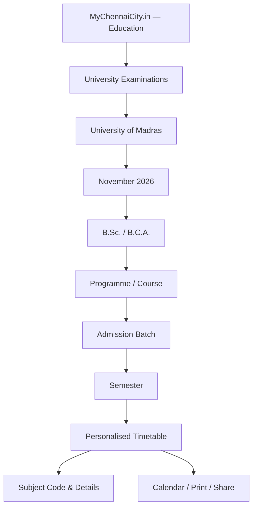
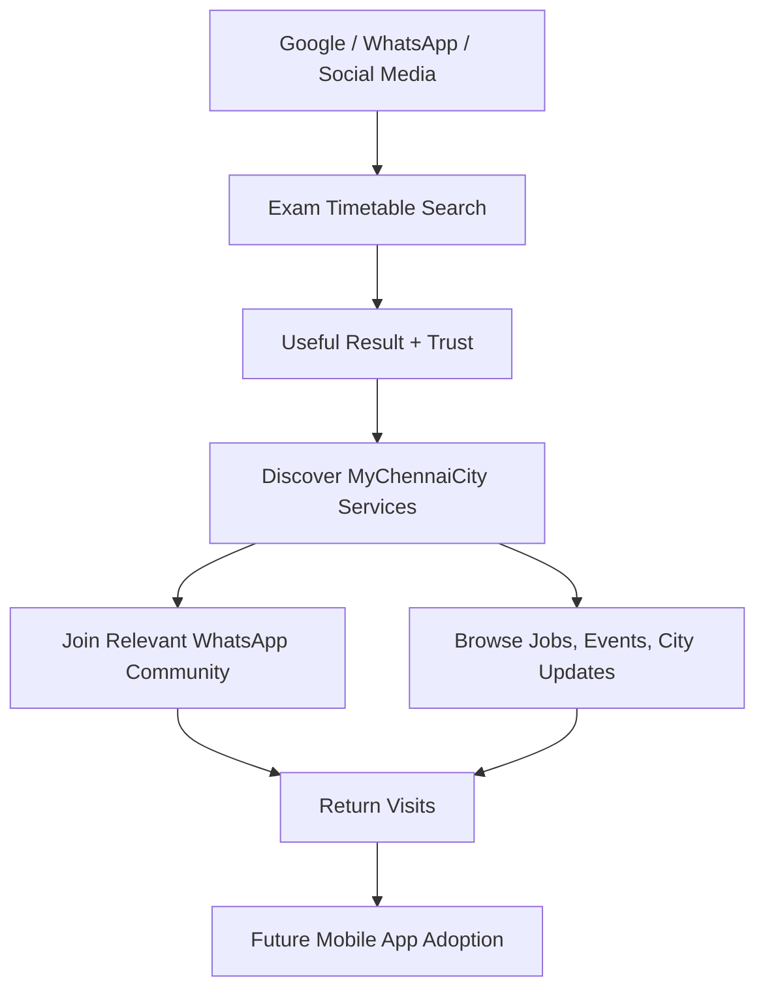
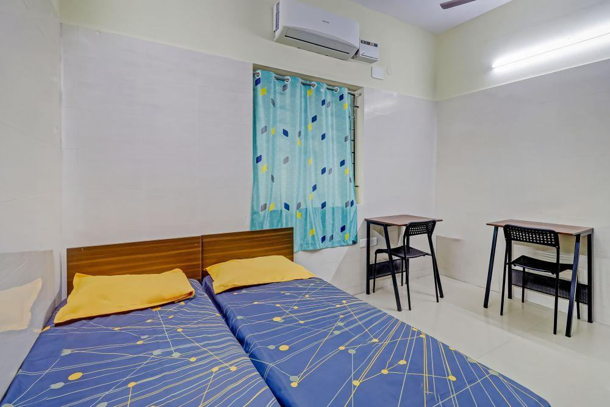
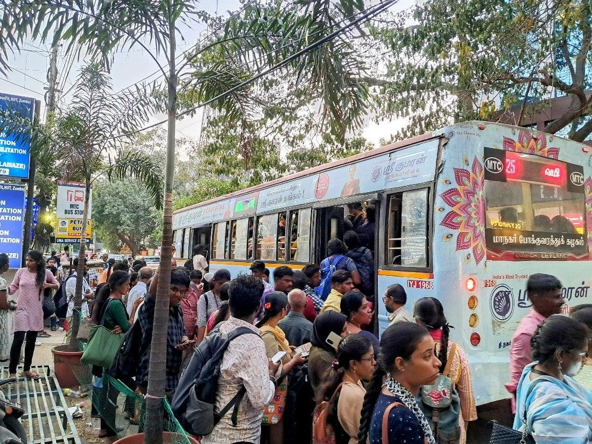
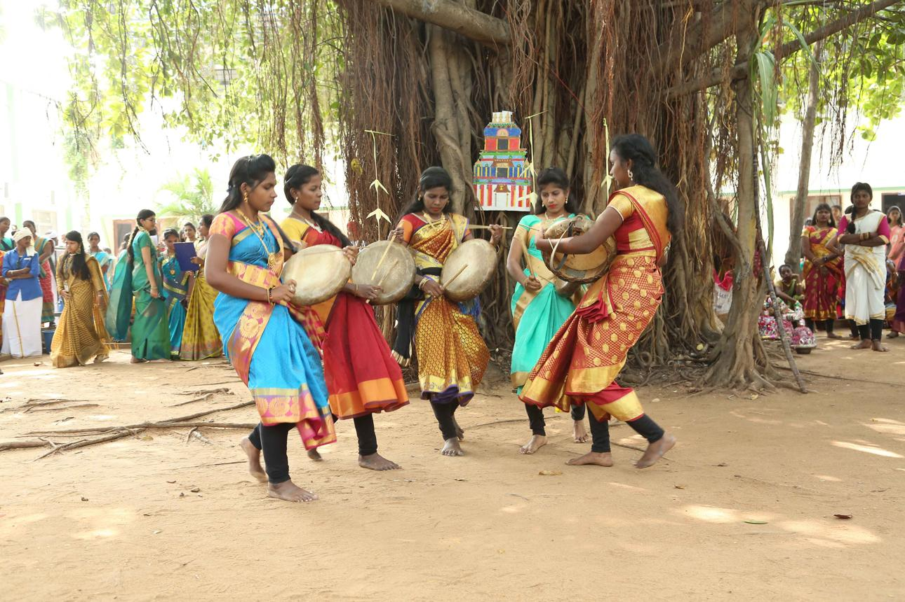

# Information Categorisation Plan

Extracted from the shared ChatGPT conversation: https://chatgpt.com/share/6aec0869-09c0-83ee-9535-5eedc7510598

These are the four visible ChatGPT replies. Flow diagrams are Mermaid (they render in preview). Layout cards from the chat are written out as sections. The four service-card pictures are the images that chat displayed, saved beside this file.

---

## Response 1 — Information architecture

**You said:**

how and all can we categorise this entire information to be posted into a url into an existing information searching website like mychennaicity.in

i want you to first plan on how and all you will categorise and organise for information presentation

**ChatGPT said:**

# MyChennaiCity.in — University Examination Information Portal

**Information architecture and presentation plan — Version 1.0**

I have examined the 28-page University of Madras B.Sc./B.C.A. November 2026 examination timetable.

**My recommendation is to convert the entire PDF into structured, searchable examination records**, accessible through a dedicated URL on MyChennaiCity.in.

The objective is to allow students to retrieve their examination information in seconds without reading or scrolling through 28 PDF pages.

## 1. Understanding the source document

| | |
| --- | --- |
| Document | **28** pages |
| Examination | **Nov 2026** semester exams |
| University | **Madras** — B.Sc. / B.C.A. |

The document contains multiple academic programmes, admission-year curriculum versions, six semesters, foundation subjects, core papers, electives and allied subjects. The published sessions are FN (10 AM–1 PM) and AN (2 PM–5 PM).

The PDF contains approximately 30 distinct programme titles or specialisations, with separate curriculum variants for many of them. It also contains shared examination papers, so a single date can correspond to many subject codes.

This distinction is essential: **one subject name does not always mean one examination record**, and students with different admission years may follow different syllabi.

## 2. Proposed information categorisation

I recommend organising the information into nine primary dimensions.

| Category | Information to capture |
| --- | --- |
| 1. University | University of Madras |
| 2. Examination session | November 2026 |
| 3. Degree | B.Sc. / B.C.A. |
| 4. Programme | Computer Science, Physics, Zoology, Mathematics, etc. |
| 5. Admission batch / regulation | 2022–23, 2023–24 and applicable subsequent batches |
| 6. Semester | I, II, III, IV, V, VI |
| 7. Subject category | Language, English, Core, Elective, Allied |
| 8. Examination details | Date, day, FN/AN, starting time, ending time |
| 9. Subject identification | Paper title, subject code, marks, source page |

The admission batch must be explicitly distinguished from the examination year.

### Programme classification

The programmes can also be grouped into user-friendly academic families.

**Life Sciences**

Zoology, Advanced Zoology and Biotechnology, Biochemistry, Biotechnology, Microbiology, Plant Biology and Plant Biotechnology

**Computer and Technology**

Computer Science, Software Applications, B.C.A., Computer Science with Data Science, Computer Science with Artificial Intelligence, Electronics and Communication Science, Electronics with Artificial Intelligence

**Physical and Mathematical Sciences**

Physics, Chemistry, Mathematics, Statistics, Mathematics with Computer Applications, Physics with Computer Applications

**Applied and Interdisciplinary Studies**

Psychology, Electronic Media, Hotel and Catering Management, Home Science specialisations

These academic families are proposed website navigation categories, not official university classifications.

## 3. Recommended portal structure

Suggested primary URL:

`mychennaicity.in/education/exams/madras-university/november-2026/`

Supporting pages could include:

- `/education/exams/` — All examinations
- `/education/exams/madras-university/` — University overview
- `/education/exams/madras-university/november-2026/bca/` — B.C.A. timetable
- `/education/exams/madras-university/november-2026/computer-science/` — Computer Science timetable

Keep one authoritative data source behind every view to avoid conflicting information across URLs.

## 4. Front-end information presentation

The page should have three levels of access:

1. **Instant search:** Enter a subject code, subject name or programme.
2. **Guided search:** Select degree, programme, admission batch and semester.
3. **Browse everything:** Explore courses, examination dates and subject categories.

Below is a suggested interactive filter layout.

> MYCHENNAICITY.IN / EDUCATION

### Find Your Exam Timetable

**November 2026**

**Search subject name or paper code**

> Search field: e.g. Genetics, 343C5B

**Degree**

- B.Sc.
- B.C.A.

**Programme**

- (select a programme)

**Admission batch**

- 2022–23
- 2023–24
- 2024–25
- 2025–26
- 2026–27

**Semester**

- Semester 1 through Semester 6

**[View My Timetable]**

*Interface concept. A published version will connect these fields to the fully verified examination database. The selected batch must map to the applicable regulation.*

## 5. How examination results should appear

Once a student makes a selection, the portal should present the information in multiple formats.

**View 1 — Personal timetable**

Chronological list of relevant papers, with examination date, session, paper title and code. This should be the default view.

**View 2 — Calendar view**

Monthly or weekly calendar showing morning and afternoon examinations. Suitable for identifying gaps between papers.

**View 3 — Subject code lookup**

Exact-match search for paper codes, including multiple codes assigned to the same examination.

**View 4 — Date-wise examination browser**

Select any date and see all examinations scheduled that day, classified by degree, programme and session.

**View 5 — Printable and shareable timetable**

A compact A4 print layout, downloadable PDF, and a link that preserves the selected filters for WhatsApp sharing.

## 6. Individual subject record design

Every examination paper should be stored with structured metadata.

| Database field | Example |
| --- | --- |
| University | University of Madras |
| Examination | November 2026 |
| Degree | B.Sc. |
| Programme | Zoology |
| Programme code | SW2 |
| Curriculum group | Admitted from 2023–24 |
| Semester | V |
| Category | Core |
| Subject | Evolutionary Biology |
| Paper code | 343C5A |
| Date | 12 November 2026 |
| Session | FN |
| Time | 10:00 AM–1:00 PM |
| Source | Original PDF, page 4 |

This example is taken from the supplied timetable.

The complete schema should additionally support:

- Multiple subject codes per examination
- Applicable admission-year ranges
- Maximum marks, where stated
- Cross-listed or common papers
- Original subject-title wording
- Source page and source-document version
- Verification status
- Published corrections and update history

I recommend keeping separate entities for programmes, curriculum versions, papers and examination events. This avoids duplicating common papers across several courses.

## 7. Search-engine information architecture

MyChennaiCity.in is an information discovery website. Therefore, its examination pages should support both internal search and public search engines.

| Search intent | Recommended landing page |
| --- | --- |
| Madras University November 2026 timetable | Main examination page |
| Madras University BCA exam timetable | Degree page |
| B.Sc. Computer Science November 2026 | Programme page |
| Madras University 5th semester timetable | Semester-filtered page |
| Subject code 343C5A exam date | Paper lookup result |
| November 12 university exams | Date-wise page |

Each indexable page should contain a unique title, useful explanatory content, verified timetable records, and a link to the official source.

Avoid generating thousands of near-duplicate SEO pages from combinations of filters. Only publish indexable URLs for useful, distinct content.

## 8. Additional features for the information portal

| Priority | Feature | Why |
| --- | --- | --- |
| Priority 1 | Exact subject-code search | Students can identify their examination without knowing the programme's internal grouping. |
| Priority 1 | Batch-aware filtering | Prevent students from confusing older and newer curriculum papers. |
| Priority 1 | Source verification | Link every entry to the exact original PDF page. |
| Priority 1 | Mobile-friendly timetable | Make the exam schedule readable without horizontal scrolling. |
| Priority 2 | Calendar download | Export selected examinations into a student's calendar. |
| Priority 2 | WhatsApp sharing | Share a filtered timetable URL with classmates. |
| Priority 2 | Days remaining | Show a countdown to upcoming papers using the student's selected timetable. |
| Priority 3 | Change alerts | Show verified university revisions and timetable updates. |
| Priority 3 | Multi-university support | Extend the same structure to Anna University, TNOU and other universities. |

## 9. Implementation sequence

| Phase | Deliverable |
| --- | --- |
| 1. Extraction | Extract all rows from the 28-page PDF |
| 2. Classification | Assign degree, programme, batch, semester and paper category |
| 3. Normalisation | Resolve wrapped titles, shared papers, multiple codes and curriculum differences |
| 4. Validation | Compare extracted records against the PDF, flag missing or ambiguous entries |
| 5. Search system | Build indexes for subject name, subject code, programme, semester and date |
| 6. Front-end | Create responsive timetable, search, filtering and detail views |
| 7. Publishing | Add structured page URLs, metadata and official-source attribution |
| 8. Maintenance | Maintain a revision workflow for corrected and subsequent examination schedules |

**Important validation issue:** The PDF contains at least one row where the subject code appears missing or malformed, under Financial Accounting I in the allied subjects section. Such records must be flagged for manual verification, never guessed. The portal should also make clear that the university's official notifications take precedence over the convenience view.

## 10. Long-term structure for MyChennaiCity.in

This should become one module of a larger education information system.

### MyChennaiCity.in / Education

*City-wide academic information hub*

- Exam Timetables
- Exam Notifications
- University Results
- Syllabus & Regulations
- College Information
- Hall Ticket Information
- Admissions & Counselling
- Academic Announcements

### Final recommendation

Build this as a **data-driven University Examination Search Engine** within MyChennaiCity.in, not as a conventional article containing a long table.

For the first release, prioritise:

1. Complete, validated conversion of all 28 pages.
2. Programme-, batch- and semester-specific timetable retrieval.
3. Exact paper-code search.
4. Date-wise and calendar-based presentation.
5. Mobile-first design, printing and WhatsApp sharing.
6. Permanent, search-friendly URLs.
7. Clear reference to the University of Madras as the official source.

The same information architecture can later support other examination cycles, degrees, universities and educational institutions without rebuilding the system.

---

## Response 2 — Official PDF source

**You said:**

find the online source of the orginal pdf link

**ChatGPT said:**

Found the **original PDF on the official University of Madras website**.

**Official university source verified**

### B.Sc. / B.C.A. Examination Timetable — November 2026

University of Madras | 28 pages | Admission batches 2022–23 to 2026–27

**[Open Original PDF](https://egovernance.unom.ac.in/internal/timetable/BScBCA.PDF)**

Direct PDF URL:

https://egovernance.unom.ac.in/internal/timetable/BScBCA.PDF

**Official timetable directory:**

[University of Madras — November 2026 Examination Timetables](https://egovernance.unom.ac.in/internal/timetable/tt.html)

The university published the November 2026 timetable announcement on **3 November 2026**.

I verified that the linked PDF contains 28 pages and matches the title, examination period, and admission-batch coverage of your uploaded document.

For MyChennaiCity.in, use this direct PDF URL as the official source reference on the searchable examination timetable page.

---

## Response 3 — One-page launch

**You said:**

as of now long term can hold

i just want to capitalise this infomration which i have on hand
To be posted in mychennaicity website and increase userbase but provide a useful service

**ChatGPT said:**

The immediate objective for MyChennaiCity.in should be **turning the University of Madras November 2026 timetable into a useful student-facing search tool that attracts organic traffic and WhatsApp referrals.**

Do not build a complete education portal now. Build one focused utility around the 28-page PDF.

## Recommended launch: My Exam Timetable

**Proposed URL:** `mychennaicity.in/madras-university-exam-timetable-2026/`

**Page headline:**

> University of Madras November 2026 Exam Timetable — Find Your Exam Date, Subject Code & Session Instantly

**Value proposition:**

> No need to search through 28 PDF pages. Select your course and semester or enter your subject code to find your exam schedule.

## 1. What the student should see

> MYCHENNAICITY.IN / STUDENT SERVICES

### Find Your Exam Date

Madras University — November 2026

**Search by subject code or name**

Enter code, e.g. 343C5A

---

OR FIND BY COURSE

- Degree
- Course
- Admission Batch
- Semester

**[View My Exam Timetable]**

---

**Example search result** · **Verified from PDF**

B.Sc. Zoology | Semester V | Evolutionary Biology

### 12 Nov 2026

Thursday · **FN Session**

10:00 AM – 1:00 PM

Paper Code: 343C5A

*Verified example from page 4 of the official timetable.*

## 2. Launch with only six features

| Feature | Why it matters |
| --- | --- |
| Subject code search | Fastest way to identify an individual examination |
| Course and semester filters | Helps students find all relevant papers |
| Date-wise results | Allows students to check exams on a specific date |
| Morning/afternoon session details | Prevents confusion about timings |
| WhatsApp sharing | Encourages students to circulate the page |
| Original PDF link | Provides credibility and source verification |

The most important feature is **subject-code search**, because students can immediately verify a paper without navigating complex university categories.

## 3. How to acquire users

**Google Search**

Optimise the page for searches such as “Madras University November 2026 timetable”, “BCA November 2026 exam dates”, and “BSc 5th semester timetable 2026”.

**WhatsApp circulation**

Distribute the link through relevant student groups, college communities and class representatives. Share it as a useful timetable lookup, not a promotional advertisement.

**Student-to-student sharing**

Every filtered result should have a Share Timetable button. The link should open the same course and semester selection for the recipient.

**MyChennaiCity audience building**

Add a small, optional link to follow MyChennaiCity's student updates. Keep the timetable available without registration or mandatory WhatsApp joining.

## 4. Suggested promotional message

**Madras University November 2026 Exams — Find Your Timetable Instantly**

Studying B.Sc. or B.C.A. under the University of Madras?

The November 2026 examination timetable is available.

Instead of searching through the 28-page PDF, find your examination details in seconds.

- Search by subject code
- Select your course and semester
- Check exam dates and timings
- Share your timetable with classmates
- Access the original university PDF

**Check your exam timetable:**
https://mychennaicity.in/madras-university-exam-timetable-2026/

A free student information service from MyChennaiCity.in.

*Timetable information is based on the official University of Madras publication. Always check university updates for revisions.*

*Promotional copy for use after the search page is published and verified.*

## 5. How success should be measured

Track these five metrics from the first day:

- Unique visitors to the timetable page
- Number of subject-code searches
- Number of successful timetable lookups
- WhatsApp share-button clicks
- Visitors arriving from Google, WhatsApp and other channels

Use privacy-conscious analytics. No student account or personal information is required for timetable lookup.

## 6. Execution priority

### Immediate launch checklist

**One-page utility**

- [ ] Extract and validate the examination records from all 28 PDF pages
- [ ] Build subject-code search and course/semester filters
- [ ] Display verified examination date, time and paper details
- [ ] Add official PDF reference and correction disclaimer
- [ ] Implement mobile layout, sharing and analytics
- [ ] Publish the URL and begin student-focused distribution

**My recommendation:** Launch this as a standalone, mobile-first examination lookup page within MyChennaiCity.in, without logins, advertisements blocking the content, or unnecessary features.

The useful service attracts the student. Accurate search results build trust. Sharing brings additional visitors. MyChennaiCity branding introduces those visitors to the wider platform.

That is the immediate opportunity in the information you already possess.

---

## Response 4 — Acquisition, WhatsApp, and the future app

**You said:**

see by landing in this page - i need to bring to attension on other features of mychennaicity.in and make the user hooked to our website - our whatsapp group and also make aware and make them a permanen patron of mychennaicity.in

in the recent future we'll be hosting a mobile app also

**ChatGPT said:**

# MyChennaiCity.in — Student Acquisition, Engagement & Retention Strategy

The University of Madras examination timetable should become an **entry point into the wider MyChennaiCity ecosystem**, not just a page students visit once and forget.

The business objective is to convert a one-time examination search into a lasting relationship with MyChennaiCity.in.

### Proposed user journey

There are three distinct goals:

1. **Acquisition:** Attract students searching for the November 2026 exam timetable.
2. **Activation:** Get them to discover at least one other relevant MyChennaiCity service.
3. **Retention:** Encourage them to join an appropriate WhatsApp community, return to the website, and eventually adopt the mobile app.

The design must balance these goals. If promotions obstruct the timetable, students may leave before discovering anything else.

## 1. Build the landing page around three layers

**Layer 1 — Primary utility**

### Find Your University Exam Timetable

Search by paper code, programme, admission batch or semester.

Search → Timetable Results → Share

*Give the visitor exactly what they came for, without mandatory registration.*

**Layer 2 — Service discovery**

### What Else Can MyChennaiCity Help You With?

- Jobs & Internships
- PG & Accommodation
- Transport & Commute
- Events in Chennai
- Education Updates
- Chennai News

*These are recommended service categories. Link only to features already published; label upcoming ones clearly.*

**Layer 3 — Audience retention**

### Stay Connected With Chennai

Get useful local updates through MyChennaiCity's WhatsApp community and explore the website regularly.

**[Join the MyChennaiCity Community]**

Education • Jobs • Transport • Events • City Updates

**Community invite URL to be connected**

*The future mobile app becomes an additional retention channel after launch.*

## 2. Create a student-focused discovery section

Students visiting the exam timetable are a useful audience segment. They are likely to need other information before and after graduation.

Rather than promoting every website category equally, prioritise services related to their immediate needs.

### Recommended service cards

**Student audience**

**Jobs & Internships**

Local vacancies, walk-ins and career opportunities

**High relevance**

**PG & Room Sharing**

Accommodation and shared-room information

**High relevance**

**Chennai Transport**

Buses, Metro, routes and commuting information

**Events & Activities**

Competitions, workshops and city events

For the examination timetable audience, I would rank the promotions in this order:

1. Education announcements and examination updates
2. Jobs, internships and walk-in recruitment
3. PG accommodation and room sharing
4. Transport and commuting
5. Local events, competitions and workshops
6. General Chennai news and civic information

This is the starting editorial priority, not a claim about measured user preferences.

## 3. Position WhatsApp as a continuing service

Do not simply display a generic "Join WhatsApp" button.

Explain why joining has value.

### Stay Updated With MyChennaiCity

Useful Chennai information in one community.

- University Updates
- Local Job Alerts
- Chennai News
- Events & Activities
- Transport Updates
- Community Information

---

MyChennaiCity WhatsApp Community

Join voluntarily to discover updates and relevant discussions. Message frequency and categories should be clearly described.

### WhatsApp structure

Use the existing MyChennaiCity community as the primary destination, with an announcements group for broad updates.

As membership grows, create interest-specific groups only when there is sufficient content and moderation capacity.

| Component | Purpose |
| --- | --- |
| Community announcements | Important updates across Chennai |
| Education & students | Examinations, admissions and education-related information |
| Jobs & careers | Recruitment information |
| Events & activities | Local events, workshops and competitions |

Where appropriate, maintain a WhatsApp Channel for one-way public updates. A Channel and a Community are different products and should have distinct entry links.

Avoid posting every update to every subgroup. Relevance is necessary for retention.

## 4. Give the visitor reasons to return

The examination timetable has a short useful life. The next visit needs a new reason.

### Student engagement lifecycle

1. **First visit — Examination lookup.** Student finds the relevant timetable, verifies the paper code and shares the result.
2. **During examination period.** Provide relevant university announcements, verified timetable revisions and next-exam access.
3. **After examinations.** Introduce result announcements, career information, internships and local opportunities.
4. **Long-term engagement.** Continue with Chennai news, transport, accommodation, jobs, events and community information.
5. **After mobile app launch.** Invite returning users to install the app for faster access and interest-based notifications.

The website should keep a "Recently viewed timetable" shortcut on the same device, using local browser storage. Students should not need an account to use this feature.

## 5. Prepare for the upcoming mobile app

Do not make the future app the dominant message now.

Introduce the concept through a small section near the bottom of the page.

**Coming in the future**

### MyChennaiCity Mobile App

Your city's useful information, accessible from one app.

Planned experience: Chennai news, jobs, local information, events and personalised updates.

*Do not display App Store or Play Store download links until the app is actually available. A launch-notification signup can be added when a working consent and notification system exists.*

For future app migration, the website and app should use the same content database, URL structure and category taxonomy. This will reduce duplicated content-management work.

## 6. Recommended page placement strategy

| Page location | Content | Purpose |
| --- | --- | --- |
| Top header | MyChennaiCity logo, navigation | Brand awareness |
| First screen | Exam search | Immediate value |
| After search results | Share and save timetable | Organic distribution |
| Below results | Two highly relevant service cards | First cross-site interaction |
| Mid-page | WhatsApp community invitation | Community conversion |
| Further down | Jobs, transport, events and Chennai information | Broader discovery |
| Near footer | Mobile app coming soon | Future product awareness |
| Footer | About MyChennaiCity and other services | Brand familiarity |

On mobile, use a compact sticky header that gives access to the main site. Avoid full-screen popups, compulsory community joining, automatic WhatsApp redirects or intrusive banners.

## 7. Measure whether visitors become regular users

The key distinction is between traffic and retention.

### Launch measurement framework

| | |
| --- | --- |
| Acquisition | Unique visitors and traffic sources |
| Utility | Successful timetable lookups |
| Discovery | Clicks to other MyChennaiCity sections |
| Community | WhatsApp invite clicks and attributable joins, where measurable |
| Retention | Returning visitors within 7 and 30 days |
| App interest | Voluntary launch-notification signups, if implemented |

Tracking a WhatsApp invite click does not prove that the user joined. Community conversions should be measured separately where reliable attribution is available.

## 8. The immediate 10-day launch approach

| Days | Work |
| --- | --- |
| 1–3 | Extract, structure and validate the PDF data |
| 3–5 | Build and test the responsive timetable search |
| 5–6 | Integrate MyChennaiCity branding, navigation and service discovery |
| 6–7 | Add WhatsApp invitations, sharing and analytics |
| 8 | Test across mobile devices and verify paper-code searches |
| 9 | Publish and index the page |
| 10 | Start distribution through relevant college and community channels |

This is an indicative schedule, assuming the existing website can accept a new page and the PDF data can be validated without major extraction problems.

---

## My recommendation

Treat the examination timetable as a **student acquisition campaign with a useful search service at its centre**.

Use this priority order:

1. Deliver the timetable result accurately and quickly.
2. Expose the student to relevant MyChennaiCity services.
3. Convert interested visitors into WhatsApp community members.
4. Use continuously updated local information to earn repeat visits.
5. Convert an established returning audience into mobile app users when launched.

The most important principle is that students should remember **MyChennaiCity as the place where they found something useful**, rather than remembering only an examination timetable.

That brand association, reinforced through useful services and relevant community updates, is the foundation for turning occasional visitors into regular patrons.

---

If you want, I can:

- Develop WhatsApp community engagement plan
- Create content for mobile app announcement
- Plan user retention features for website

The share stopped there. Those three follow-ups were offered and not answered.
