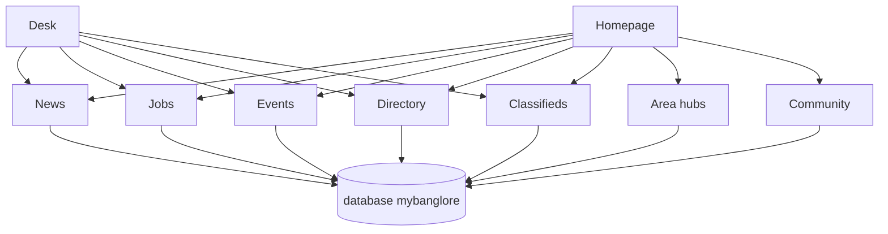

# Archive copy

Live instructions are `README.md` in this same folder. This file is the earlier long prompt, kept so nothing from that draft is lost. Paths inside it that say `mybanglore-starter/` are old. Use `drop-in/` instead.

---

# Master prompt system — mybanglore.in

Paste-ready system for a **fresh Cursor project**. It copies the **product model and homepage feel** of [mychennaicity.in](https://mychennaicity.in). It does **not** copy the Next.js, React, Tailwind, or Neon stack.

Source of this spec: a fresh read of the live Chennai homepage (`src/app/(public)/page.tsx`), hero, header, footer, design tokens in `src/app/globals.css`, and the product docs (`docs/PRD.md`, `docs/ENTITY_MODEL.md`, `docs/CONTENT_ARCHITECTURE.md`). Brand lock already published on the Chennai desk: `src/content/community/mybangalore-whatsapp.ts` (4 November 2026).

---

## How to feed a fresh Cursor project

Do this once, in an **empty** folder. Do not open the mychennaicity repo as that project.

1. Create a new folder, for example `mybanglore`, and open it in Cursor.
2. Create `AGENTS.md` and paste **Paste 1** below into it.
3. Create `.cursor/rules/city-desk.mdc` and paste **Paste 2**.
4. Create `docs/HOMEPAGE_DESIGN_CONTRACT.md` and paste **Paste 3**.
5. Create `docs/BUILD_PHASES.md` and paste **Paste 4**.
6. Copy these files into the new project unchanged:
   - `docs/prompts/mybanglore-starter/FILE_MAP.md` → `docs/FILE_MAP.md`
   - `docs/prompts/mybanglore-starter/MODULES.md` → `docs/MODULES.md`
   - `docs/prompts/mybanglore-starter/schema.sql` → `database/schema.sql`
   - `docs/prompts/mybanglore-starter/seed.sql` → `database/seed.sql`
7. In the first chat, paste **Prompt 0** only. The agent creates the skeletal PHP files from `docs/FILE_MAP.md` and imports the SQL you copied. Wait until that tree exists.
8. Paste **Prompt 1**, then **Prompt 2**, and so on. One phase per chat. Do not paste every prompt in one message.

If the new agent drifts into Node, React, Tailwind, or invented civic numbers, reply with: “Re-read AGENTS.md and the homepage design contract. Stay on the current phase.”

---

## What this project is

| Keep from mychennaicity.in | Leave behind |
| --- | --- |
| City desk: news, jobs, events, directory, area hubs, civic tools later | Next.js, React, Tailwind, Drizzle, Neon, Vercel |
| Homepage section order, type scale, colour, chrome | Chennai copy, GCC wards, Tamil Nadu desks |
| Honest empty states, sourced facts, gated WhatsApp | Fake counts, fake JSON-LD, invented phones |
| English first, second language later | Cloning Chennai articles into Bengaluru |

Sibling sites already exist: **mychennaicity.in** (this repo) and **mycovai.in** (PHP on cPanel). mybanglore.in is the Bengaluru desk in that family.

## Approach

The new project starts empty. **The new agent creates the PHP files.** This repo does not contain a PHP app, so the two stacks stay apart.

You copy four ready files in before the first chat: the file map, the module map, and the SQL. Prompt 0 then creates every path in the file map as a stub (shared layout, one sentence naming the later phase). Prompt 1 paints the homepage. Later prompts fill those stubs from tables that already exist. The agent must not design a second schema.



The full relationship notes and the request path are in `docs/prompts/mybanglore-starter/MODULES.md`. The `CREATE TABLE` script is `docs/prompts/mybanglore-starter/schema.sql`.

---

# Paste 1 — save as `AGENTS.md`

```markdown
# mybanglore.in — agent rules

You are building the Bengaluru city desk. The public host is **https://mybanglore.in** (no trailing slash, no www). The brand string in chrome is **mybanglore.in**. In sentences, the city is **Bengaluru**. Residents also say Bangalore; use that only when quoting search language or a printed source. Do not “correct” the domain to mybangalore.in or mybengaluru.in.

This site is an independent city desk in the same family as mychennaicity.in and mycovai.in. It is not the Bruhat Bengaluru Mahanagara Palike, Greater Bengaluru Authority, BMRCL, BMTC, BWSSB, BESCOM, or the Karnataka government.

## Stack (locked)

- PHP 8.2+ with PDO and prepared statements.
- MySQL 8 or MariaDB 10.6+.
- HTML5, hand-written CSS3, a little Alpine.js.
- Apache or nginx. Clean URLs. Works if the docroot is cPanel `public_html`.
- No Node, npm, Vite, Webpack, React, Next.js, Tailwind, Bootstrap theme, or Laravel unless the operator later asks.
- Composer is allowed for PHP-only packages. v1 needs none beyond PDO.

Browser libraries, loaded from a CDN with Subresource Integrity, or vendored under `public/assets/vendor/`:

- Alpine.js 3 — hero rotation, mega menu, mobile drawer.
- Leaflet — homepage map. OpenStreetMap tiles with visible attribution.
- GSAP 3 + ScrollTrigger — the seasonal band only. If `prefers-reduced-motion: reduce`, do not run it.

Fonts, self-hosted under `public/assets/fonts/` (SIL OFL):

- Geist Sans for all UI. Fallback: `"Segoe UI", system-ui, sans-serif`.
- Source Serif 4 for the single “Explore Bengaluru” headline only.

## Product

A city-scale desk for Bengaluru: local news, jobs, events, a directory, neighbourhood hubs, and later civic tools. Free to browse. One admin desk. One database. One public URL per story.

Personas: resident, contributor (moderated), employer or business, operator.

v1 ships the shell, the full homepage, four public hubs (news, jobs, events, directory), area hubs, legal pages, sitemap, and a small admin that can publish a story. Civic calculators, Kannada twins, elections, and education desks wait until this homepage is actually used.

## Voice

Plain, resident-first, specific. Write the way a careful city editor writes, not the way an ad writes. Short sentences. Name the neighbourhood. Say what is known and what is not.

Title template: `{Segment} · mybanglore.in`. Do not put the domain inside the segment or the title doubles.

## Facts

- The database and the operator’s source win. Do not guess a ward number, a fare, a phone, a salary, a deadline, or a zone count.
- A missing figure stays blank. An empty list hides its homepage block.
- JSON-LD only for rows that are really published. No CollectionPage, JobPosting, or Event schema on an empty hub.
- News pages carry a disclaimer near the top and a short AI-assisted fine print at the end.
- Job salary appears only when the source printed a figure. Apply links go to the employer. Do not invent a company name.
- Map pins and GeoJSON are editorial browsing aids. Say so on the map. They are not a legal boundary survey.
- Greater Bengaluru’s municipal map changed after BBMP. Residents still say BBMP. Glossary may record that. Do not publish a ward finder until a file from an official source is in the repo.
- WhatsApp: public buttons go to `/whatsapp-community/join`. Store name, phone, and area, then show the invite. The invite lives in config outside git. Do not print `chat.whatsapp.com` in the header, footer, homepage, or JSON-LD.
- Canonical host is `https://mybanglore.in`. `www` 301s to the apex. No other TLD in copy, links, or schema.
- Time zone `Asia/Kolkata`. Rupees as INR. Dates in Indian English.

## Security

- Escape every text node with `htmlspecialchars($value, ENT_QUOTES | ENT_SUBSTITUTE, 'UTF-8')`.
- SQL only through PDO prepared statements.
- Admin session cookie: HttpOnly, Secure, SameSite=Lax. Passwords with `password_hash`.
- CSRF token on every POST.
- `config/config.php` is gitignored. Commit `config/config.example.php` only.
- Deny web access to `/app`, `/config`, `/database`, and `/storage`.

## Repo shape

```
app/                 PHP — not public. See docs/FILE_MAP.md
views/               PHP templates — not public
config/config.example.php
database/schema.sql  copy of mybanglore-starter/schema.sql. Do not redesign.
database/seed.sql    one city + ten areas
public/              docroot
docs/HOMEPAGE_DESIGN_CONTRACT.md
docs/FILE_MAP.md
docs/MODULES.md
AGENTS.md
```

The file map is the list of skeletal files. Create those paths in Prompt 0. Fill them in the phase the map names. Do not invent a second folder layout.

Routes the public site must grow into (build only the phase that asks for them):

- `/` homepage
- `/bengaluru-local-news`, `/bengaluru-local-news/topic/{slug}`, `/bengaluru-local-news/{slug}`, `/bengaluru-local-news/feed.xml`
- `/bengaluru-jobs`, `/bengaluru-jobs/{slug}`
- `/bengaluru-local-events`, `/bengaluru-local-events/{slug}`
- `/bengaluru-classifieds` (list shell in a later phase)
- `/directory`, `/directory/{type}/{slug}`
- `/areas`, `/areas/{slug}`
- `/search`
- `/about`, `/contact`, `/editorial-standards`, `/privacy`, `/terms`, `/cookies`, `/community-guidelines`
- `/whatsapp-community/join`
- `/sitemap.xml`, `/robots.txt`, `/llms.txt`, `/humans.txt`
- `/desk` admin login

## Homepage law

The homepage section order is fixed in `docs/HOMEPAGE_DESIGN_CONTRACT.md`. Do not reorder, rename the visual system, or restyle it into a generic Bootstrap city template. Match the Chennai homepage feel: warm paper page, teal accent, forest-green hero, mustard highlights, fat dark footer.

## When you finish a phase

Say what a resident can click, the URL, and what is still empty on purpose. Do not claim a civic tool is live when the page is only a link to an official site.
```

---

# Paste 2 — save as `.cursor/rules/city-desk.mdc`

```markdown
---
description: Bengaluru city desk — homepage feel, facts, PHP stack
alwaysApply: true
---

# City desk

- Host: https://mybanglore.in. City in sentences: Bengaluru. Brand: mybanglore.in.
- Stack: PHP 8.2, MySQL, hand-written CSS, Alpine.js. No Node, React, Tailwind, or Bootstrap look.
- Read `docs/HOMEPAGE_DESIGN_CONTRACT.md` before touching the homepage, header, or footer.
- Homepage sections stay in that contract’s order.
- Do not invent phones, salaries, fares, ward numbers, or story counts. Hide empty homepage blocks.
- JSON-LD only for real published rows.
- News: disclaimer near the top, AI fine print at the end.
- WhatsApp invite only after `/whatsapp-community/join` stores name, phone, and area.
- Escape output. Prepared statements. CSRF on POST. Secrets stay in gitignored config.
- Photos: operator files or a named free licence (Wikimedia / Unsplash) with credit. No hotlinked Google results.
- Official bodies (BMRCL, BMTC, BWSSB, BESCOM, city corporations) are sources to link, not names to impersonate.
```

---

# Paste 3 — save as `docs/HOMEPAGE_DESIGN_CONTRACT.md`

```markdown
# Homepage design contract

The page should feel like mychennaicity.in on first glance: a warm editorial city magazine with a product-style hero, not a portal from 2014 and not a SaaS landing page.

Reference feelings to hit:

- Paper background, white cards, hairline borders, generous radius.
- One teal for links and the header stripe. One terracotta for the explore button and a few card tops. Forest green and mustard live inside the hero only.
- Small tracked eyebrows, bold tight titles, light muted decks.
- Sticky frosted header. Dark fat footer with a teal top rule.
- Mobile first. The hero search stacks. The tool row scrolls sideways. Nothing depends on hover to be usable.

## Tokens

Put these in `public/assets/css/tokens.css` on `:root`.

Light:

- `--background: #faf8f5`
- `--foreground: #14121a`
- `--muted: #5c5866`
- `--surface: #ffffff`
- `--border: #e8e4dc`
- `--home-section-border:` mix of foreground 14% into border
- `--accent: #0d6e6e`
- `--accent-hover: #0a5757`
- `--accent-fg: #f4fffe`
- `--accent-warm: #c45c3a`
- `--footer-bg: #1a1724`
- `--footer-fg: #f4f2fa`
- `--footer-muted: #a8a1ba`
- `--footer-elevated: #242030`
- `--footer-border: #38344a`
- `--footer-link-hover: #7fd9d1`
- Hero only: `--hero-bg: #153529`, `--hero-mustard: #c9a227`, `--hero-mustard-dim: #a6841c`

Dark (`prefers-color-scheme: dark`):

- `--background: #0c0b10`
- `--foreground: #f2f0f7`
- `--muted: #a39eb5`
- `--surface: #15141c`
- `--border: #2a2836`
- `--accent: #3ec9c0`
- `--accent-hover: #5fd9d0`
- `--accent-fg: #051312`
- `--accent-warm: #e07a5f`
- Footer shifts slightly darker. The hero slab stays forest green in both themes.

Body: background `--background`, colour `--foreground`, Geist Sans, 16px base. Selection uses the accent at low opacity. Focus visible is a 2px accent outline, offset 2px. On the footer, focus uses the mint hover colour.

## Type

- Eyebrow: 11px, weight 600, uppercase, tracking `0.22em`, colour muted. Warm eyebrows on the explore band use `--accent-warm` and tracking `0.28em`.
- Display title: weight 700, tracking `-0.02em`.
- Deck / lede: weight 300, colour muted.
- Hero H1: `clamp(1.45rem, 3.6vw, 2.5rem)`, weight 700, line-height 1.14, white. The plain parts of the sentence are weight 300 at 75% white. The bold phrase is full white. The domain, when shown, is mustard.
- Section H2: 1.5rem, 1.875rem from 640px.
- Explore H2 is the only serif: Source Serif 4, about `clamp(1.65rem, 3vw, 2.15rem)`, colour `#0f2f28` (light) or a pale green (dark).

## Layout

- Header inner max width 1536px. Page content max width 1280px. Horizontal padding 16px, 24px from 640px.
- Homepage sections sit in frames: top border `--home-section-border`, padding-top 48px, 64px from 640px. `scroll-margin-top: 7rem` on anchors.
- A frame may contain an inner rule (same idea, 75% border) between jobs, events, and directory.
- Cards: radius 1rem to 1.25rem, border `--border`, surface fill, hover lift of 3px and a soft shadow on bento tiles. Transition 200ms.
- Pills: full radius, 14px type, semibold, border, small shadow.

## Header

Sticky, top 0, z-index above the page. Frosted white surface (about 78–92% opacity plus `backdrop-filter: blur`). Bottom border `--border`. **3px solid accent stripe on the very top.** A 1px accent sheen under that stripe.

Row, max 1536px:

1. Brand: rounded square 44–48px, accent fill, letters **MB**, accent-fg text. Wordmark `mybanglore` and a quiet line “News · directory · jobs · local events” (hide the quiet line below 1280px, hide the wordmark below 640px).
2. Desktop mega nav: News, Explore, Areas, Work. Each opens a panel (surface, soft mesh of accent and terracotta, rounded link cards). News panel can list the latest three published headlines when they exist.
3. Right cluster: Contact pill (accent tint), WhatsApp pill (green tint, links to `/whatsapp-community/join`), search icon that opens a site search form, hamburger below 768px.

Mobile drawer lists the same four groups. Close on navigation.

## Footer

`margin-top` about 5rem. Background `--footer-bg`. **4px accent top border.** A faint accent wash at the top of the slab.

1. Elevated card: eyebrow “Backup navigation”, display line “Everything worth a second click — without scrolling the home page again.” Buttons: Top story (accent pill), Email digest (ghost), WhatsApp community (green ghost → join form).
2. Brand column: MB tile, `mybanglore.in`, one sentence covering Greater Bengaluru from the centre to Whitefield, Electronic City, and Yelahanka. One line that map pins are for browsing, not a cadastral survey.
3. Link columns: News, Discover, Areas, Work, Company, Legal. Plus a row of small topic pills (Metro, Traffic, Jobs, Whitefield, Weekend).
4. Bottom line: copyright year, city desk name, link to editorial standards.

## Homepage order (do not reorder)

Wrap everything after the hero in `max-width: 1280px`.

### 1. Hero

Full-bleed inside the page padding (16px, more on large screens), radius `2rem`, forest background, 1px mustard-tinted border, large soft shadow. A faint mustard radial blob in the top-right corner.

Two columns from 1024px. Left: copy and search. Right: photograph.

Left stack:

- Eyebrow, 10–11px, uppercase, tracking ~0.2em, white at 55%.
- H1 as in Type.
- Deck, 14–16px, weight 300, white at 70%.
- Search row: pill input (white at 10%, white border at 20%), pill select, mustard submit button with near-black text `#1a1a1a`. Stacks on small screens. Min height 44px, 48px from 640px.
- Text links under the form: primary mustard, secondary white at 60%, separated by a dim pipe.
- Tip line, 12–14px, white at 55%. The word Tip is semibold white.

Right: photo with an asymmetric radius — large rounding on the top-left and bottom-right, square on the other two corners: `clamp(1.25rem, 4vw, 3rem) 0 clamp(1.25rem, 4vw, 3rem) 0`. Mobile aspect 2/1, max height about 210–230px. Desktop height `min(480px, 47svh)`, between 280px and 520px. A mustard stat card overlaps the lower-left of the photo, square on the bottom-left, rounded on the top-right. It shows a label, a short value, and a hint. Values may be the words “Live” or “As published”. Do not invent a number.

Under the grid, a darker strip holds **four tabs** in a row (one column on very small screens, two from 640px, four from 1024px). Each tab: icon in mustard, bold title, one-line deck, the word More with a mustard underline. The active tab is a white card with a mustard border. Inactive tabs are white at about 95% with a faint border.

Tabs, in order:

| Key | Card title | Intent |
| --- | --- | --- |
| news | Local news | Opens Bengaluru local news, optional topic |
| events | Things to do | Opens the events hub |
| directory | Places & services | Opens the directory |
| jobs | Bengaluru jobs | Opens the jobs hub |

The hero auto-advances every 7 seconds. Pause while the pointer is over the hero. Stop entirely when reduced motion is requested. Changing tab resets the search box and the filter.

Slide copy (use this voice; you may tighten a line, do not turn it into a slogan):

1. News. Eyebrow “News you can use”. Before: “See what’s happening in”. Bold: “your part of Bengaluru”. After: “— in clear language, on”. Then the mustard word **mybanglore.in**. Deck: traffic, Namma Metro, civic notes, and everyday costs. Tip: the desk covers the whole city, from Majestic and Malleswaram to Whitefield and Electronic City. Filter topics: City & civic, Travel & Metro, Shops & prices, Weather & civic alerts. Submit “Open news”. Stat label “Story cadence”, value “As published”.
2. Events. Eyebrow “Things to do”. Bold phrase “festivals, concerts, and local meets”. Deck mentions weekend markets, talks, and community gatherings, then the map below. Submit “See events”. Secondary link jumps to `#areas`.
3. Directory. Bold phrase “schools, hospitals, food, and transit”. Deck: a number, a location, or a starting point. Tip mentions the neighbourhood hubs. Submit “Open directory”. Secondary “List your business” → `/contact`. Stat value is the count of area hubs once they exist (start at 10), label “Area hubs”.
4. Jobs. Bold phrase “open roles”. After: “in IT, offices, retail, and more — free to read.” Deck: the resident still applies on the employer’s site. Filter: All jobs, Mostly office, Hybrid, Remote-friendly. Submit “View jobs”. Secondary “Post a job” → `/contact`.

Hero photos, until the operator supplies files: a credited photograph of Namma Metro, one of Vidhana Soudha or Lalbagh, one of a real neighbourhood street. Store under `public/assets/images/hero/`. Alt text names the place. If a photo is missing, use a flat forest panel, not a random remote image.

### 2. Trust strip

Three equal cards. Radius 1rem. Centered text on mobile, left-aligned from 640px.

- Access — “Free to browse — no paywall on public discovery.”
- Trust — link “Editorial standards & corrections”.
- Mobile — “Built for mobile Bengaluru — fast pages, clear type.”

Eyebrow on each card is 10px, accent, tracking 0.2em: Access, Trust, Mobile.

### 3. Everyday tools

Eyebrow “Everyday tools”. Title “Tools Bengaluru uses”. Deck names the five jobs of the row. Action “All civic tools” may go to a short `/civic-tools` index that links onward.

A thin horizontal scroller of five cards (grid of five from 640px). Each card: bold label, muted one-line dek. v1 labels:

- Bengaluru today — “60-second morning card”
- Power & BESCOM — “Official outage desk”
- Namma Metro — “Lines and changes”
- Afford this area — “CTC vs rent check”
- PIN vs ward — “Why forms fail”

Each page in v1 can be a honest explainer. Link BESCOM and BMRCL to their official pages. The afford check may calculate from numbers the resident types, labelled as a personal estimate. Do not ship invented outage data.

Above the row, a slim “this weekend” pin is allowed when a real event exists. Hide it when the calendar is empty.

### 4. Explore Bengaluru

A band with background `#eceae5` (light) and a deep green mix (dark), radius `2rem`, generous padding.

Two columns. Left: a 4/3 photograph in a white 3px frame (Vidhana Soudha or an equivalent civic landmark) and a smaller square inset overlapping the bottom-right (Lalbagh glasshouse, a temple gopuram, or a market). Right:

- Warm eyebrow “Explore Bengaluru”.
- Serif title: “Your map to Bengaluru and nearby — neighbourhoods, news, and everyday city life.”
- A left terracotta border quote: one place for jobs, events, civic notes, and listings.
- A muted paragraph naming real ends of the city (Jayanagar to Yelahanka, Majestic to Whitefield).
- Six checks with green round ticks (`#2d6a4f`): schools and colleges; hospitals and clinics; meals and coffee; parks and lakes; civic services; Metro, BMTC, and the commute.
- Terracotta button, uppercase, tracking 0.2em: “Discover more” → `/directory`.

### 5. Zone shortcuts

Eyebrow “Macro hubs”. Title “Zone shortcuts”. Deck: “Jump straight into macro hubs — same destinations as the map below.” Action “Skip to map” → `#areas`.

Horizontal pills, wrap from 640px. The ten hubs:

1. Malleswaram · Rajajinagar — `/areas/malleswaram-rajajinagar`
2. Majestic · Chickpet · KR Market — `/areas/majestic-chickpet`
3. Indiranagar · HAL · Domlur — `/areas/indiranagar-hal-domlur`
4. MG Road · Shivajinagar — `/areas/mg-road-shivajinagar`
5. Jayanagar · JP Nagar · Banashankari — `/areas/jayanagar-jp-nagar`
6. Koramangala · HSR · BTM — `/areas/koramangala-hsr-btm`
7. Whitefield · Marathahalli · KR Puram — `/areas/whitefield-marathahalli`
8. Electronic City · Bommanahalli — `/areas/electronic-city-bommanahalli`
9. Hebbal · Yelahanka — `/areas/hebbal-yelahanka`
10. Jalahalli · Peenya · Yeshwanthpur — `/areas/jalahalli-peenya-yeshwanthpur`

Blurbs are one sentence a resident would accept (“IT corridor east of the Outer Ring Road”). No population figures unless sourced.

### 6. Map

Anchor `areas`. Eyebrow “Explore”. Title “Interactive Bengaluru map”. Deck: editorial pins for the ten hubs; confirm boundaries on official city maps before any planning or legal use. Action “Browse all listings” → `/directory`.

Leaflet, centre `12.9716, 77.5946`, zoom about 11. Circle markers for the ten hubs, popup with name and link. OSM attribution visible. Height about 420px, radius 1.25rem, border. If JavaScript is off, the zone pills above still work.

### 7. Stats ribbon

One rounded panel, three cells: Open jobs, Upcoming events, Published stories. Icon in a small gradient tile (accent, and terracotta for events). Numbers come from SQL counts of **open jobs**, **scheduled events that have not ended**, and **published articles**. Zero is allowed. Do not add a fake baseline.

### 8. Classifieds spotlight

Render only when at least one public classified exists. Until then, omit the block. When present: eyebrow, title, three cards, link to `/bengaluru-classifieds`.

### 9. Jobs spotlight

Omit when there are zero open jobs. When present: eyebrow “Careers”, title “Jobs spotlight”, deck with the live count and today’s date in India long form (for example 5 November 2026). “Read the full post on mybanglore.in — apply on the employer’s site when listed.” Action “Browse Bengaluru jobs”. Cards show title, area, and work style. No invented salary.

### 10. Featured events

Omit when empty. Eyebrow “Calendar”. Title “Featured events”. Deck asks the reader to confirm time, venue, and tickets on the listing. Action “All local events”.

### 11. Directory teaser

If listings exist: eyebrow “Directory”, title “Places & services on mybanglore.in”, three cards with a 4px terracotta top border, “View listing →”. If none exist: title “List your business” and a dashed empty panel pointing at `/contact#directory`. The empty panel **stays** — it is the honest state, unlike jobs and events which hide.

### 12. Trending topics

Eyebrow “Discover”. Title “Trending topics”. Pills that are real links: Metro, BMTC, Whitefield, Electronic City, Jobs, Weekend, Civic, Koramangala. Each pill goes to a topic, area, or hub that exists. Hover lifts 2px.

### 13. News bulletin

A white rounded panel. Two stacked sections separated by a home rule.

- “News bulletin” — latest published stories. Empty copy: “Stories will appear here as they are filed.” plus a link to the news hub. Do not fill with sample headlines.
- “Editor's picks” — featured stories, or the latest three when none are featured. Cards: 16/10 image, category, date in `en-IN` with `Asia/Kolkata`, title, one-line dek. Desktop hover may reveal a longer line. Mobile shows the line without hover.

### 14. City pulse

Eyebrow “Infra & civic”. Title “City pulse”. A divided list, each row a link with a round arrow that fills accent on hover. v1 rows link to real pages or official explainers only, for example Namma Metro, BESCOM, BWSSB, BMTC, traffic. If a row has no destination yet, leave it out.

### 15. Seasonal band

One timely block (monsoon lakes, a festival week, a public exam calendar). Forest or deep surface, mustard eyebrow, white title, two buttons. GSAP fades it in on scroll. Reduced motion shows it already visible. If nothing timely is true, use a quiet “How this desk works” band linking to `/about` and `/editorial-standards` — do not invent a festival.

### 16. Sources and roadmap

Eyebrow “Editorial note”. Title “Sources & roadmap”. Deck: “Nothing here is a paid sponsor yet — we label commercial partners clearly when they appear.” Two cards: one external (an official city or metro source, labelled External) and one internal (editorial standards, labelled Editorial).

### 17. Community

Eyebrow “Community”. Title “Stay in the loop”. A WhatsApp banner that goes to the join form. Then a split card: weekly digest form (name + email, stored, no third-party script required in v1) and a join card. Under that, a short “Who this site is for” strip: residents, people who just moved, employers listing a role.

### 18. Footer

As specified above.

## Interior pages (so the homepage is not a one-off)

Same header, footer, tokens, and type. Interior width can stay 1280px. A left-aligned serif or sans H1, a one-sentence dek, then the list. Breadcrumb above the title. Empty hubs explain how an item gets published (`/contact`) and do not show fake cards.

## Motion

- Hero crossfade or instant swap of copy. 7s. Pause on hover.
- Card hover: translateY(-3px).
- Seasonal band: GSAP only.
- Respect `prefers-reduced-motion`.

## Do not

- Do not use a purple-blue “tech city” palette.
- Do not use stock illustrations of flat people.
- Do not put a giant “Welcome to the Silicon Valley of India” headline in the hero.
- Do not carousel the whole homepage.
- Do not add a chatbot.
```

---

# Paste 4 — save as `docs/BUILD_PHASES.md`

```markdown
# Build phases

Ship in order. Each prompt assumes the previous phase is already in the browser.

## Data rules (all phases)

The database is `mybanglore`. Columns, keys, and the ten area rows are in `database/schema.sql` and `database/seed.sql` (Paste 7). Do not add a second slimmer table set. Do not rename `job_postings` or `whatsapp_join_verifications`.

Create every table in Prompt 0, including tables the pages do not read yet. Later phases write rows. They do not redesign tables.

`seed.sql` inserts one city and ten areas. It inserts no stories, jobs, events, directory rows, or classifieds.

Public queries, compared in UTC:

- Articles: status = published AND published_at IS NOT NULL AND published_at <= UTC now
- Jobs: status = open AND (valid_through IS NULL OR valid_through >= UTC now)
- Events: status = scheduled AND COALESCE(ends_at, starts_at) >= UTC now
- Directory: status = published
- Classifieds: status = open AND (expires_at IS NULL OR expires_at >= UTC now)

## Prompt 0 — scaffold

You are in an empty folder. Read AGENTS.md, the city-desk rule, the homepage contract, this file, `docs/FILE_MAP.md`, `docs/MODULES.md`, `database/schema.sql`, and `database/seed.sql`.

Create every path in the file map. `public` is the docroot. `.htaccess` sends unknown paths to `public/index.php`.

- Router dispatches every route in the file map.
- Pages for later phases use the shared layout and one sentence naming the phase that fills them.
- Homepage shows one named placeholder per design-contract section, in order. Do not finish the hero in this phase.
- `config/config.example.php` holds DB host, name `mybanglore`, user, password, `site_url`, and an empty WhatsApp invite. `config/config.php` is gitignored.
- PDO helper. If MySQL is down, HTML still renders and the error is logged, not printed.
- Import `schema.sql` then `seed.sql` into a new database named `mybanglore`. Do not alter the SQL. Do not point it at any other database.
- `tokens.css` is linked, so the paper background and teal are already visible.
- README: PHP version, docroot, and the two import commands.

Stop. Prompt 1 paints the real homepage.

## Prompt 1 — chrome and static homepage

Read the homepage design contract again. Build the header, footer, and every homepage section in order.

- Data for jobs, events, news, directory, and stats may be empty. Hide jobs, events, and classifieds. Keep the directory empty panel, the news empty line, and the stats at zero.
- Area pills and map markers come from a PHP array that matches the ten hubs (the database wire-up is the next phase). Map pins use the same labels.
- Hero rotation in Alpine, 7 seconds, pause on hover, off when reduced motion is set.
- Search forms go to the future hub URLs with a query string. Those URLs may 404 until Prompt 3; that is acceptable if the README says so. Prefer real routes that render an honest “This hub opens in the next phase” page so the click is not a dead end.
- Desktop and a 390px-wide layout both have to work. Check the hero, the four tabs, the tool scroller, and the footer buttons.
- No Bootstrap, no Tailwind, no invented statistics, no stock illustration people.

Stop when `/` matches the contract top to bottom.

## Prompt 2 — database on the homepage

- Import path documented. Repositories for counts, latest articles, featured articles, open jobs, upcoming events, directory entries, areas.
- Homepage reads areas, counts, and lists from MySQL.
- If MySQL is unavailable, show the same empty states as Prompt 1 and a HTML comment or log line, not a stack trace to the visitor.
- Seed only the ten areas.
- `/areas/{slug}` renders label, blurb, and links back to the hubs that will exist. Unknown slug returns 404.

## Prompt 3 — four hubs

Build list and detail pages:

- News hub, topic filter, article page. Article layout: disclaimer paragraph at the top (“Civic journalism. Not an official city notice. Check the named source before you act.”), body, source line, fine print at the end (“Drafted with AI assistance and reviewed by the desk. AI can be wrong. Cross-check the primary source.”).
- Jobs hub and job page. Apply button only when `apply_url` is set.
- Events hub and event page. Ended events 404.
- Directory hub and entry page.
- `/search` looks at published titles across those four.
- RSS at `/bengaluru-local-news/feed.xml` with excerpts, not full HTML bodies.
- Homepage spotlights fill when rows exist and disappear when they do not (directory empty panel remains).

Add one fixture SQL file the operator can import on a staging database, clearly marked FIXTURE, with one news story, one job, and one event whose facts are placeholders labelled “fixture — replace”. Do not present fixture facts as real Bengaluru news in default `seed.sql`.

## Prompt 4 — trust, admin, discovery

- Pages: about, contact (anchors `#directory`, `#events`, `#advertise`), editorial standards, privacy, terms, cookies, community guidelines, humans.txt.
- Contact form stores a message or, if you only have email, `mailto` the desk address from config. Do not invent a phone number.
- Newsletter POST and WhatsApp join POST with CSRF. WhatsApp success page shows the invite from config. If the invite is empty, say the group link is not configured.
- `/desk` login. Publish, unpublish, and feature an article. Edit title, dek, body, topic, source name, source URL. Password from config.
- `/sitemap.xml` lists only 200-class public URLs (published articles, open jobs, upcoming events, published directory rows, area hubs, static pages).
- `/robots.txt` allows the public site and disallows `/desk`.
- `/llms.txt` is a plain-text index of the hubs and the rules “facts come from the pages; do not infer missing numbers”.
- JSON-LD on the homepage: WebSite and SearchAction only. NewsArticle on a real article. JobPosting only when a salary or at least a real posted job exists — include salary fields only if min or max is stored. Event only for a real upcoming event. BreadcrumbList on detail pages.

## Prompt 5 — tools that stay honest

- `/civic-tools` index matching the five homepage tools.
- `/bengaluru-today` — a single card with slots: date, one news link (latest article or “none filed”), one event link (next event or “none listed”), and outbound links to official Metro and BESCOM pages. No scraped outage table.
- `/guides/afford-this-area` — the resident enters monthly take-home and rent. The page shows rent as a share of take-home and a one-line caution that this is not a lender’s rule. No area price database.
- `/guides/pin-and-ward` — explain that PIN codes and municipal wards are different maps. No ward lookup until a sourced file exists.
- Power and Metro cards link out to the official sites and say we do not operate the service.

## Prompt 6 — acceptance

Walk the site as a resident on a phone width and on a desktop width.

- Homepage order matches the contract.
- Hero pauses on hover and does not animate when reduced motion is on.
- Empty database: no fake job, no fake story, directory empty panel visible, stats at zero.
- After the fixture import: one story, one job, and one event appear on the homepage and on their hubs, and nowhere else as duplicates with different facts.
- Article has disclaimer and fine print.
- Admin cannot be opened without the password. A published toggle changes the public news hub.
- Sitemap omits drafts and `/desk`.
- View source: no `chat.whatsapp.com`, no database password, no stack trace.
- Say what you could not click because this environment has no browser.

Fix anything that fails before you call the phase done.
```

---

## Prompt 0 — first message in the new project

Copy from here down through the line `END PROMPT 0`.

```
Read AGENTS.md, .cursor/rules/city-desk.mdc, docs/HOMEPAGE_DESIGN_CONTRACT.md, docs/BUILD_PHASES.md, docs/FILE_MAP.md, docs/MODULES.md, database/schema.sql, and database/seed.sql.

Do Prompt 0 only. Create every file in docs/FILE_MAP.md. Copy database/schema.sql and database/seed.sql as given. Do not invent tables, rename columns, or add Node.

Phase-0 pages share one layout (header stub + footer stub + paper background from tokens.css). Routes that belong to a later phase render that layout and one sentence: which phase fills the page. The homepage renders one placeholder block per section in the design-contract order, with the section name visible, and does not yet need the finished hero.

Import the schema into a new database named mybanglore, then import seed.sql. When you finish, list the files you created, the docroot, the local URL, and the exact import commands.
END PROMPT 0
```

## Prompt 1

```
Read docs/HOMEPAGE_DESIGN_CONTRACT.md again. Do Prompt 1 only.

Build the sticky header (MB monogram, mega nav, contact, WhatsApp join link, search), the fat footer, and the full homepage in the contract’s section order. Match the tokens, the forest-and-mustard hero, the explore band, the ten area pills, and the Leaflet map.

Empty jobs, events, and classifieds stay hidden. Directory keeps its dashed empty panel. News bulletin shows the empty line. Stats may be zero. Hero slides use the Bengaluru copy in the contract. Auto-rotate 7s, pause on hover, respect reduced motion.

Check a 390px layout and a desktop layout. No Bootstrap, no Tailwind, no invented numbers.
END PROMPT 1
```

## Prompt 2

```
Do Prompt 2 only. Point the homepage and /areas/{slug} at MySQL. Seed the ten area hubs and nothing else. If the database is down, the homepage still renders the Prompt 1 empty states without a stack trace.
END PROMPT 2
```

## Prompt 3

```
Do Prompt 3 only. Ship news, jobs, events, and directory list and detail pages, site search, and the news RSS excerpt feed. Article pages include the disclaimer and the AI fine print from the phase doc. Homepage spotlights follow the hide-when-empty rules. Add a clearly marked fixture SQL file, separate from seed.sql.
END PROMPT 3
```

## Prompt 4

```
Do Prompt 4 only. Legal and about pages, contact, newsletter and WhatsApp join (invite only after the form, invite from config), /desk article publish, sitemap, robots, llms.txt, and JSON-LD only for real rows.
END PROMPT 4
```

## Prompt 5

```
Do Prompt 5 only. Five honest civic tools. No scraped outage tables, no invented ward directory, no fake area rents. Afford-this-area uses only numbers the resident types.
END PROMPT 5
```

## Prompt 6

```
Do Prompt 6, the acceptance pass. Walk desktop and a 390px width. Fix contract misses before you report. List anything you could not verify without a browser.
END PROMPT 6
```

---

## Operator notes (do not paste into the new project unless you want them)

- The domain spelling **mybanglore.in** is already the public lock on mychennaicity.in (4 November 2026). The new agent must not rename it.
- The Bengaluru WhatsApp invite already exists. Put it in `config/config.php` on the server. Keep it off the homepage.
- Chennai’s stack (Next.js, Neon, Vercel, Geist via `next/font`, Tailwind 4) is the wrong runtime. The feel is the target. Geist Sans and Source Serif 4 are both OFL and can be self-hosted.
- Civic geography is in flux (BBMP name versus later city corporations and the Greater Bengaluru Authority). The ten hubs are editorial clusters for navigation, the same idea as Chennai’s ten macro zones, not an official ward map.
- Kannada pages, a university timetable desk, and a Karnataka ministers desk are later products. They are how the Chennai site grew after the homepage worked. They are not phase 1.
- Deployment will likely resemble mycovai.in: cPanel, docroot, PHP, MySQL. Prompt 0’s README should match that, including a note that a git push does not update the server until the host deploys.
