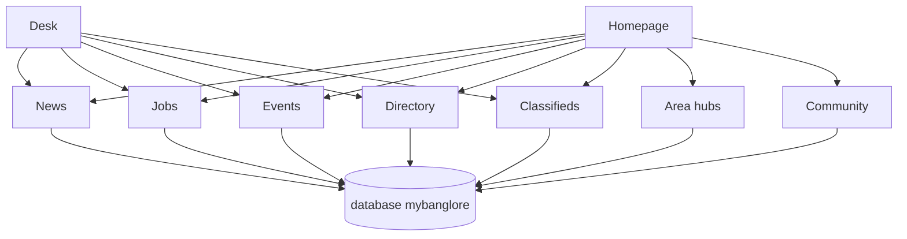

# Session record — mybanglore.in briefing

Written 5 November 2026 so the chat answers travel with the folder. The new project reads this file. The rules in `AGENTS.md` and the design contract win if a line here is older.

## Brand

- Public host: **https://mybanglore.in** (no www, no other TLD).
- That spelling is already published on mychennaicity.in (4 November 2026). Do not rename it to mybangalore.in or mybengaluru.in.
- In sentences the city is **Bengaluru**. “Bangalore” only when quoting search language or a printed source.
- Same family as mychennaicity.in and mycovai.in. Independent of BBMP, the Greater Bengaluru Authority, BMRCL, BMTC, BWSSB, BESCOM, and the Karnataka government.
- The WhatsApp invite already exists. It stays in server config. Public buttons go to `/whatsapp-community/join`, store name, phone, and area, then show the invite.

## What to copy from Chennai, and what to leave

Copy the product: news, jobs, events, directory, area hubs, civic tools later, the homepage section order, the type scale, the colours, the chrome, empty states, sourced facts, gated WhatsApp, English first.

Leave the stack: Next.js, React, Tailwind, Drizzle, Neon, Vercel, Chennai copy, GCC wards, Tamil Nadu desks. Do not clone Chennai articles into Bengaluru.

Runtime for the new site: PHP 8.2, MySQL 8 or MariaDB 10.6, HTML5, hand-written CSS, Alpine.js, Leaflet, GSAP for the seasonal band only. No Node build. Geist Sans and Source Serif 4, self-hosted. cPanel-style docroot is acceptable, the way mycovai.in is deployed. A git push does not update the server until the host deploys.

## Homepage feel

Warm paper `#faf8f5`, teal `#0d6e6e`, terracotta `#c45c3a`, forest hero `#153529`, mustard `#c9a227`, fat footer `#1a1724`. Sticky frosted header with an MB monogram. Section order is fixed in `HOMEPAGE_DESIGN_CONTRACT.md`: hero, trust, tools, explore, zone pills, map, stats, classifieds, jobs, events, directory, topics, news, city pulse, seasonal band, sources, community, footer.

Empty jobs, events, and classifieds hide. The directory keeps a dashed empty panel. Stats may be zero. No invented phones, salaries, fares, or ward numbers.

## Approach (second answer)

The new agent creates every PHP file from `FILE_MAP.md`. Prompt 0 is the skeleton. Tables are created in full on day one from `schema.sql`. Later phases insert rows. They do not redesign tables.

One front controller. A repository reads MySQL. A view renders. The homepage only reads. The desk is the writer, and the first desk screen publishes articles.

## Database

One database, `mybanglore`. Eighteen tables. `seed.sql` inserts the city and ten area hubs only.

| Group | Tables |
| --- | --- |
| Place | `cities`, `areas` |
| Desk | `users`, `audit_log` |
| News | `articles` |
| Work | `employers`, `job_postings`, `job_seeker_posts` |
| Calendar | `events` |
| Listings | `directory_entries`, `classified_listings`, `classified_phone_reveals` |
| Community | `newsletter_subscribers`, `whatsapp_join_verifications`, `contact_messages` |
| Ready, pages later | `content_engagement_events`, `redirects`, `gold_rate_snapshots`, `boundary_feedback` |

Salary, opening count, and remote policy stay null when the source printed nothing. A job has an employer row even when the note names no company; the employer name then says it was unnamed. A gated classified phone is shown only after the enquirer’s name and number are stored. WhatsApp joins are not articles. Times are UTC in the database and India time on the page. Public URLs use slugs.

Area pins in the seed are approximate browsing centres, not a legal boundary. Greater Bengaluru’s municipal map changed after BBMP. Do not publish a ward finder until an official file is in the repo.

## How the prompts run

Paste one chat prompt at a time from `chat-prompts/`. Wait until that phase is in the browser.

0. Scaffold: file map, tokens, import SQL.
1. Header, footer, full homepage.
2. Homepage and area pages read MySQL.
3. News, jobs, events, directory, search, RSS.
4. Legal pages, contact, newsletter, WhatsApp gate, `/desk`, sitemap, robots, llms.txt, JSON-LD for real rows only.
5. Five civic tools that do not invent outages, wards, or rents.
6. Acceptance on desktop and a 390px width.

Kannada pages, a university timetable, and a Karnataka ministers desk wait until this homepage is actually used.

## Usage guide (fourth answer)

Step-by-step for a new Cursor project: `USAGE.md` in this folder. Open an empty folder, copy `drop-in\` to its root, keep this pack at `docs/mybanglore-pack/`, paste `chat-prompts/00-scaffold.txt`, then run `php -S localhost:8080 -t public`.

## Fit for Bengaluru (fifth answer, 5 November 2026)

The chassis fits. The city layer is still a Chennai desk with Bengaluru nouns. Do not treat the pack as culturally finished.

Already right: English build, ten real clusters (including Majestic, Jayanagar, Malleswaram, Peenya, not only IT), honest empty data, no invented wards while civic boundaries are in flux, rent calculator from numbers the resident types, jobs table that can hold a firm or an unnamed employer.

Not yet right if left unchanged:

- Kannada is the city’s public language. Shipping a homepage with no Kannada line, and calling Kannada “later” the way Tamil was later in Chennai, reads as an outsider IT portal.
- Daily pressure here is rent, the commute (ORR, Silk Board, Whitefield, Electronic City), Cauvery / borewell / tanker water, and khata or property-tax paperwork. A BESCOM card in the top five copies Chennai’s power desk. Power matters less than those four.
- Lakes and storm drains are the monsoon story. A Chennai flood-street tool does not transfer.
- The city economy is split: IT and GCC hiring, and informal work (construction, delivery, autos, domestic work, pourakarmikas). The hero line “IT, offices, retail” only covers the first.
- PG and shared housing are a main reason people open a city site. Classifieds are in the database and easy to hide for too long.
- Old Bengaluru (Basavanagudi, Chamarajpet, Gandhi Bazaar) and the Sarjapur–Bellandur belt are thin in the first ten hubs.
- A “moved here” door matters more than it did as a Chennai extra, because so many readers are new.

No build file was changed on this review. Change the homepage contract and the five tools before Prompt 1 if the desk should feel local.

## Locked the same day

English only. No Kannada, Hindi, Tamil, or Telugu interface. About says in English that Kannada is the language of the city.

Applied in `drop-in/`:

- Tools are rent, commute and Metro, water (Cauvery, borewell, tanker), khata and tax, and Bengaluru today. BESCOM is a link on the today page.
- Twelve hubs. Added Basavanagudi · Chamarajpet and Sarjapur · Bellandur. Whitefield and Electronic City stay separate because one map pin cannot stand for both.
- Jobs line names offices, shops, IT, sites, and daily work together.
- Further ideas that are not in the build yet: `SUGGESTIONS.md`.

## This folder (third answer)

All of the above now lives in `mybanglore-pack`, including the drop-in files and the chat prompts. Move the folder whole. Append the next mybanglore decision under a new date heading in this file.
