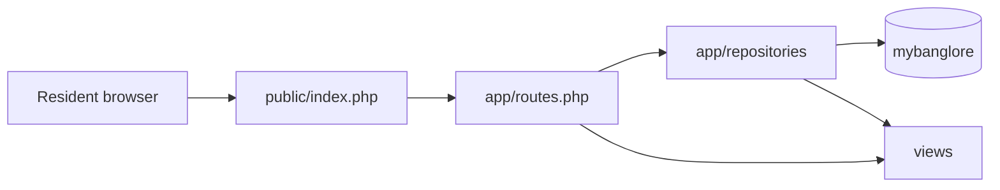
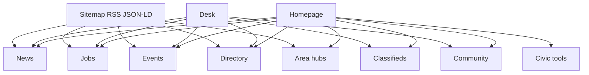
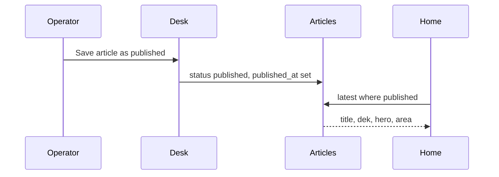

# Modules and how they connect

One MySQL database named `mybanglore`. One front controller. A page does not call another page over HTTP to fetch data. It calls a repository. The repository reads tables. The view only renders.

Store datetimes in UTC. Show them in `Asia/Kolkata`.

## Request path

## Modules

| Module | Owns | Reads on the homepage | Writes |
| --- | --- | --- | --- |
| Chrome | Header, footer, search box | Nothing from MySQL | Nothing |
| Homepage | Section order only | Counts and lists from the other modules | Nothing |
| News | `articles` | Latest and featured | Desk publish |
| Jobs | `employers`, `job_postings`, later `job_seeker_posts` | Open jobs | Desk, later |
| Events | `events` | Upcoming featured | Desk, later |
| Directory | `directory_entries` | A few published places | Desk, later |
| Classifieds | `classified_listings`, `classified_phone_reveals` | Spotlight when a row is open | Desk; the reveal form writes the enquirer |
| Areas | `areas` | Pills and map pins | Seed only, unless the desk adds a hub |
| Community | `newsletter_subscribers`, `whatsapp_join_verifications`, `contact_messages` | The form, not the rows | Public forms |
| Civic | No table in v1 | Tool links | Afford-this-area calculates in the browser from typed numbers |
| Desk | `users`, `audit_log` | Nothing public | Articles first; other modules later on the same login |
| Discovery | `redirects` | Nothing | Sitemap and feeds read public rows |
| Measurement | `content_engagement_events` | Nothing | Page view and click beacons, no IP address |
| Rates | `gold_rate_snapshots` | Nothing until a gold page exists | One row per IST date, from a named source |

## How a published story reaches the homepage

Drafts, closed jobs, ended events, and expired classifieds never appear in that query. The homepage hides the jobs, events, and classifieds blocks when the query returns no rows. The directory block stays, with a dashed empty panel.

## How the pieces depend on each other

- Every story, job, event, directory row, and classified belongs to `cities.id` for Bengaluru. The city row is what would let a later desk add another city without new tables.
- `areas.id` is optional on those rows. The label a resident sees can also be plain text in `locality_label` or `location_label` when the place is not one of the twelve hubs.
- A job cannot exist without an `employers` row. If the note names no company, the employer row is still created and its name says that the employer was unnamed on the note. Do not invent a firm.
- A classified phone is shown only after `classified_phone_reveals` stores the enquirer’s name and phone, and only when `contact_phone_gated` is true. If the flag is false, the printed phone is on the page.
- WhatsApp join rows are not articles. The invite URL is config, shown only on the thanks page.
- Engagement rows store a kind and a slug. They do not use a foreign key, so a deleted story does not have to delete history, and a banner click can use the same table.
- `redirects` is checked before a 404 so an old slug can point at the new one. Do not reuse a slug for a different story.
- `audit_log` records desk actions. It is not a public page.
- Gold rates, boundary notes, and job-seeker posts have tables now so the schema does not change shape later. Their pages wait until there is a real source.

## What the desk logs in to

Phase 4 logs into `/desk` with `users.password_hash`. One session can publish an article. Jobs, events, directory, and classifieds stay SQL or fixture until a later desk screen. Those screens use the same `users` row and write `audit_log`. Do not build a second login.
