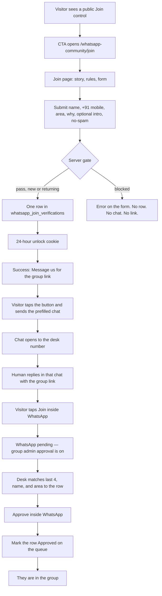
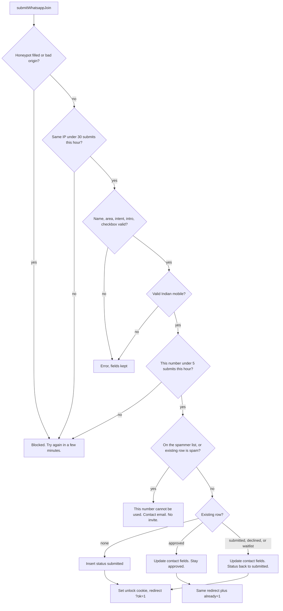
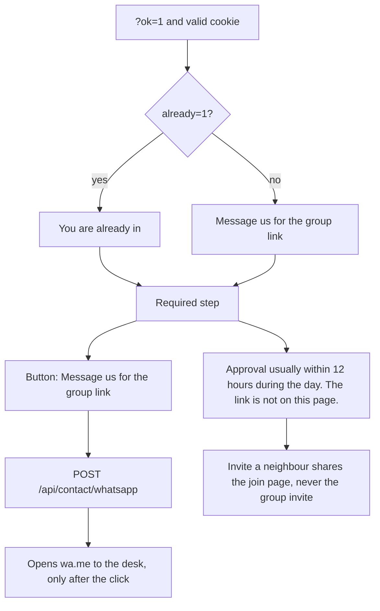
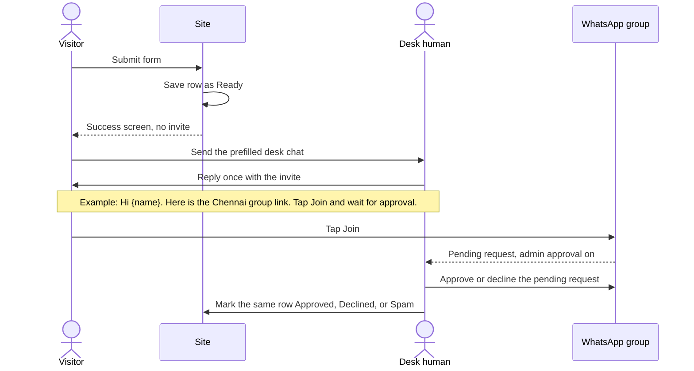
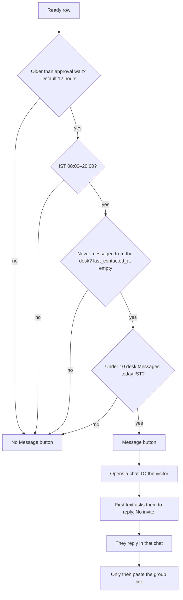
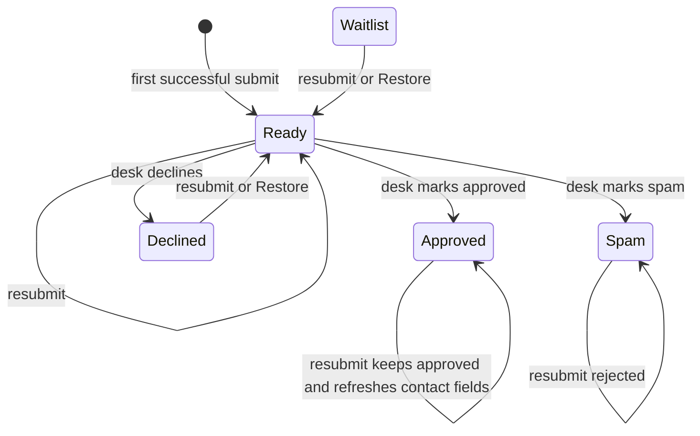

# WhatsApp join — userflow map

**Site:** https://mychennaicity.in  
**Drawn:** 23 November 2026, from the live join path (inbound desk reply, 20 November 2026).  
**Record:** `docs/strategy-marketing/WHATSAPP-GROUPS.md`  
**System:** `docs/strategy-marketing/WHATSAPP-COMMUNITY-SYSTEM.md`

The website collects a request. It does not admit anyone to the group. The group link is sent only as a human reply after the person messages the desk. WhatsApp’s own admin approval stays on.

The invite lives in `WHATSAPP_COMMUNITY_INVITE_URL`. The desk number lives in `WHATSAPP_BUSINESS_E164`. Neither value is in git, public HTML, JSON-LD, sitemaps, or the first outbound line.

## Actors

| Actor | What they do |
| --- | --- |
| Visitor | Reads the join page, submits the form, sends the required desk chat, taps Join inside WhatsApp |
| Site | Gates the form, stores one row per Indian mobile, shows the success step, keeps the admin queue |
| Desk human | Replies in the chat with the invite; later matches WhatsApp’s pending list to the row |
| WhatsApp | Holds the group. Admin approval on the group is the real admit |

## 1. Happy path

Public CTAs (header, mobile menu, footer, float, home band, article and job strips, site modal) use `whatsappCommunityJoinHref()` or `waLink('request')`. They land on the form. They do not open `chat.whatsapp.com`.

Learn pages (`/chennai-whatsapp-group`, Tamil twin, guide, partners, this-week) explain the group and still send people to the form. Old `/api/community/whatsapp` redirects to the form.

## 2. What the visitor fills in

English and Tamil are the same page (`?lang=ta`). The form shows a four-step progress cue and a `+91` prefix.

| Field | Rule |
| --- | --- |
| Name on WhatsApp | 2–120 characters |
| Mobile | Indian only: `91` + 10 digits starting 6–9. `0` prefix and a typed `91` are stripped |
| Chennai area | Must be one of the locality list, including “Other Chennai area” |
| Why | News, Jobs, Events, Neighbour help, or Listings |
| Intro | Optional, 500 characters |
| No-spam | Required checkbox |
| Website | Honeypot. Any value blocks the submit |

Hidden fields ride along: language, source, placement, partner code, UTM. They are for the row, not for the visitor.

## 3. Server gate

Limits are in-memory (`rateLimitConsume`): 30 per IP per hour, then 5 per number per hour. One row per `phone_e164`. A unique-key race updates that row instead of inserting a second one. Saving does not send email. There is no OTP.

IP is stored as a hash. The raw number is on the admin row only.

## 4. Success screen

Shown only when `?ok=1` and the unlock cookie is still valid (24 hours, httpOnly). A bare `?ok=1` without the cookie shows the form again. `ok=1`, UTM, and other query strings are `noindex`. The clean join URL stays indexable.

The button does not contain the desk number. The click POSTs same-origin. The API returns `wa.me` or `api.whatsapp.com` for `WHATSAPP_BUSINESS_E164`. A GET of that API goes to `/contact` and does not reveal the number.

Prefill the visitor sends (the API also prefixes `[mychennaicity ref:join_required]`):

> I submitted the Chennai group form as {name} from {area}. Please reply with the group link.

The success screen has no group invite, no QR of that invite, and no copy-link.

Cookie `wa_join_state=verified` is set for 180 days (reach suppression). If funnel events are on, `wa_join_verified` fires once per session, with no name and no phone.

## 5. Human reply, then WhatsApp

The site Approve button does not put them in the group. Match first, approve in WhatsApp, then mark the row.

If WhatsApp hides the number, match display name plus area, or ask them to message the desk from that account. Do not approve from a profile photo.

A crypto pitch, a number on the spammer list, or no match: decline in WhatsApp, then Decline or Spam on the row.

## 6. Rare path — they never messaged the desk

This is the risky path. Prefer the success-screen button. Use desk Message only when the person submitted and never wrote.

First text:

> [mychennaicity] Hi {first name}, you asked to join the Chennai WhatsApp group from {area}. Reply here and we will send the link.

Message is absent for Approved, Declined, Spam, and Waitlist, for a spam-list number, and for an invalid mobile. One stamp per row. The daily cap counts `last_contacted_at` since midnight IST.

A human sends it. No scripts, auto-clickers, timers, or a bank of paraphrases.

## 7. Admin queue

Login: `/super-admin` (email + password). `/admin` and `/login` redirect there.

Queue: `/super-admin/whatsapp-join-requests`

One list. These chips filter that same list. Default is Ready.

| Chip | Stored status |
| --- | --- |
| Ready | `submitted` |
| Approved | `approved` |
| Declined | `declined` |
| Spam | `spam` |
| Waitlist | `waitlist` (old rows only; the form does not file a waitlist) |
| All | every status |
| Lookup | search box on the same list: full number or last 4 |

Fifty rows a page. The row number is the order the request was first saved. The line on the row is the intro, or the intent label if the intro was blank.

Open a row: phone as typed, source, approval time and actor, last nudge, IP hash, browser, notes (2,000 characters).

| Action | Effect |
| --- | --- |
| Copy | Formatted number on the clipboard |
| Approve | `approved`, stamps `approved_at` and `approved_by`, clears declined time |
| Decline | `declined`, stamps declined time |
| Spam | `spam`, stamps declined time. Later submits of that number are rejected |
| Restore | Declined, Spam, or Waitlist back to Ready |
| Save note | Notes only |
| Message | See section 6. Posts to `/super-admin/whatsapp-join-requests/message` |
| Export CSV | Current desk export |

Status and notes are ordinary form posts. They reload the list.

Dashboard widget on `/super-admin` shows the pending count. The queue page shows a scorecard (Ready now, approved and declined windows).

## 8. Status of one number

`WHATSAPP_COMMUNITY_ACCEPTING` does not hide the form and does not switch the success screen. The public form always saves a valid request.

## 9. Where the invite is allowed

| Place | Invite |
| --- | --- |
| Nav, footer, float, modal, articles, jobs | No. Join form only |
| Join page, FAQ, JSON-LD, sitemap, `llms.txt` | No. The page says the link comes in the reply |
| Success screen and its share link | No. Share is the join URL |
| Visitor’s required desk message | No |
| Desk Message first text | No |
| Human reply after they have written | Yes. Paste `WHATSAPP_COMMUNITY_INVITE_URL` |
| Bengaluru page | A different city’s invite. Not in the Chennai join path |

## 10. Desk hours and copy the visitor sees

- Approval wait shown on success: `WHATSAPP_COMMUNITY_APPROVAL_HOURS`, default **12**, daytime.
- Desk Message window: **08:00–20:00 IST**.
- Desk Message cap: **10** a calendar day IST.
- Already approved: “You are already in the group. Send the message above if you need the link on this phone.”
- New request: “Approval usually within 12 hours during the day. The group link is not on this page.”
